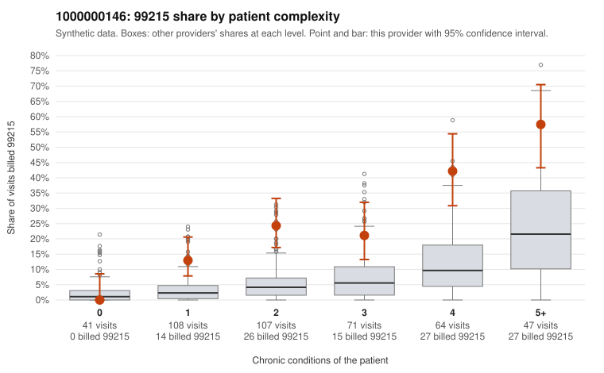

# 1000000146: Provider 1000000146 bills 99215 well above risk-adjusted expectation in every complexity band, but the few documented 99215 charts all support the billed level, so the evidence is mixed.

**Leaning (advisory):** Inconclusive

## Why

1000000146 billed 99215 on 24.9% of 438 claims against an expected 5.7% given patient complexity (risk-adjusted score 6.12; plain z-score vs peers 3.31). 13% of this provider's 99215 claims were on patients with 0 or 1 chronic conditions. Records came back for 30 claims. Of 7 documented 99215 claims, 0 (0%) were documented below the billed level, against 14% for the comparison providers. Note checks on 30 returned notes (share showing each sign): problems 13%, late 3%, unsigned 0%, data 0%. No audit trail was received. 0 of 21 notes claiming moderate-or-higher data reviewed had no lab or test line on the claim. The excess is not confined to sicker patients. The 99215 share runs roughly three to four times the all-provider share even among patients with one or two conditions (for example C0075192, C0075223 and C0075574), which a sicker panel would not explain on its own. On the other side, none of the 7 documented 99215 claims fell below the billed level, and no moderate-plus data claims lacked a lab line. That points toward supported coding, but 7 charts out of 109 99215 claims is too thin to settle the question. One detail deserves attention: C0075108, a single-condition hypothyroidism visit documented as high MDM, is also one of the notes flagged on the problems check, and the time-repeat signal is non-trivial with no audit trail received. That fits a pattern in which notes could be inflated to match the billed level, though it is not proof. A reviewer should first request more charts for the 1- and 2-condition 99215 claims listed here, together with the EHR audit trail, and confirm whether the high-MDM problem documentation reflects what actually happened at those visits. Examples: C0075108: billed 99215, patient aged 35 with 1 chronic condition(s) (hypothyroidism); documented MDM level high, minutes not recorded. C0075192: billed 99215, patient aged 72 with 1 chronic condition(s) (type 2 diabetes).

## Evidence chart

## Cited claims

`C0075108`, `C0075192`

## Suggested next steps

- 30 charts came back but do not settle it: request a targeted sample of 99215 charts, starting with C0075108, C0075192.
- Re-check after the targeted charts arrive; do not call upcoding or a sicker panel on this evidence alone.

---
Citations checked: 2/2 valid. Synthetic data. The leaning is advisory; the flag comes from the statistical screen, and no clinical documentation is available beyond the sampled records-review facts shown in the packet.
