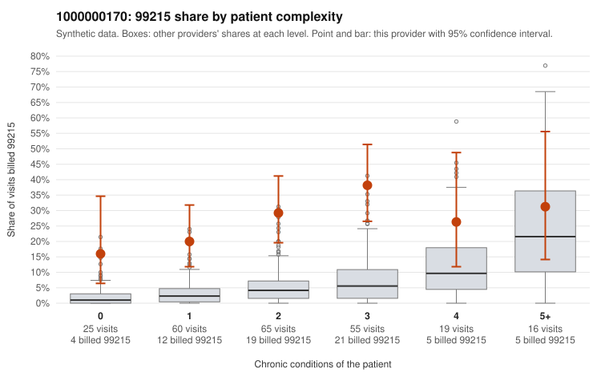

# 1000000170: 1000000170: 7 of 9 documented 99215 claims (78%) are documented below the billed level

**Leaning (advisory):** Pattern consistent with upcoding

## Why

1000000170 billed 99215 on 27.5% of 240 claims against an expected 4.8% given patient complexity (risk-adjusted score 5.74; plain z-score vs peers 3.76). 24% of this provider's 99215 claims were on patients with 0 or 1 chronic conditions. Records came back for 30 claims. Of 9 documented 99215 claims, 7 (78%) were documented below the billed level, against 14% for the comparison providers. Note checks on 30 returned notes (share showing each sign): problems 10%, late 0%, unsigned 0%, data 10%. No audit trail was received. 5 of 21 notes claiming moderate-or-higher data reviewed had no lab or test line on the claim. This pattern is consistent with upcoding. It is a reason to review the records, not a finding. Examples: C0086162: billed 99215; documented MDM level moderate, 23 minutes. C0086180: billed 99215, patient aged 50 with 1 chronic condition(s) (depression); documented MDM level moderate, 39 minutes. C0086251: billed 99215; documented MDM level moderate, minutes not recorded. C0086163: billed 99215, patient aged 62 with 1 chronic condition(s) (hyperlipidemia). C0086166: billed 99215, patient aged 39 with 0 chronic condition(s). C0086174: billed 99215, patient aged 70 with 1 chronic condition(s) (osteoarthritis).

## Evidence chart

## Cited claims

`C0086162`, `C0086180`, `C0086251`, `C0086163`, `C0086166`, `C0086174`

## Suggested next steps

- Request the full charts for C0086162, C0086180, C0086251 and have a certified coder re-score each against the current E/M rules (medical decision making or total time).
- If the re-scoring confirms the pattern, review the random sample in the recovery packet's sampling plan before any overpayment estimate; do not extrapolate from a targeted sample.
- Look at the notes themselves: 10% address fewer problems than their level implies and 0% were signed late; request the audit trail for C0086162, C0086180, C0086251.

---
Citations checked: 6/6 valid. Synthetic data. The leaning is advisory; the flag comes from the statistical screen, and no clinical documentation is available beyond the sampled records-review facts shown in the packet.
