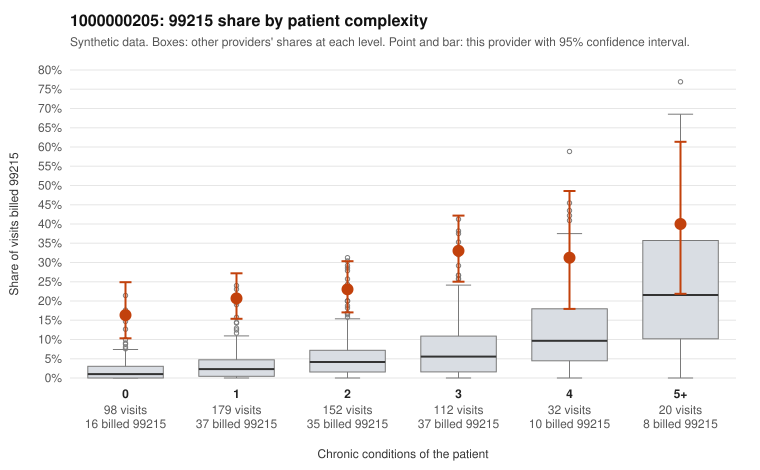

# 1000000205: Provider 1000000205 bills 99215 well above expectation in every complexity group, including patients with no chronic conditions, but its few documented 99215 charts all support the billed level, so the evidence is mixed.

**Leaning (advisory):** Inconclusive

## Why

1000000205 billed 99215 on 24.1% of 593 claims against an expected 3.9% given patient complexity (risk-adjusted score 8.84; plain z-score vs peers 3.18). 37% of this provider's 99215 claims were on patients with 0 or 1 chronic conditions. Records came back for 30 claims. Of 7 documented 99215 claims, 0 (0%) were documented below the billed level, against 14% for the comparison providers. Note checks on 30 returned notes (share showing each sign): problems 30%, late 10%, unsigned 0%, data 13%. No audit trail was received. 4 of 24 notes claiming moderate-or-higher data reviewed had no lab or test line on the claim. The excess is not explained by a sicker panel: the 99215 share is elevated in every condition-count group, including patients with zero conditions, and many sampled low-complexity 99215 claims carry simple diagnoses such as rash (R21), UTI (N39.0), URI (J06.9) or follow-up (Z09). Against that, none of the 7 documented 99215 claims fell below the billed level. However, 7 charts is too few to clear the pattern, and two of the supported examples, C0108297 (rash, no conditions) and C0108298 (Z09 follow-up, no conditions), record high MDM and 40+ minutes for visits that look simple on the claim. Both of those notes are also flagged for problem-list and late-entry signals. That, together with the duplicate and repeated-time note rates, the missing audit trail and the 4 data-reviewed notes with no lab line, is weak evidence that documentation may be inflated or cloned to match billing rather than proof of it. A reviewer should first request more charts, specifically 99215 claims on 0–1 condition patients, plus the EHR audit trail, and compare note content and timestamps for templated or copied text. Examples: C0108186: billed 99215, patient aged 51 with 1 chronic condition(s) (hypothyroidism). C0108260: billed 99215, patient aged 51 with 1 chronic condition(s) (hyperlipidemia).

## Evidence chart

## Cited claims

`C0108186`, `C0108260`

## Suggested next steps

- 30 charts came back but do not settle it: request a targeted sample of 99215 charts, starting with C0108186, C0108260.
- Re-check after the targeted charts arrive; do not call upcoding or a sicker panel on this evidence alone.

---
Citations checked: 2/2 valid. Synthetic data. The leaning is advisory; the flag comes from the statistical screen, and no clinical documentation is available beyond the sampled records-review facts shown in the packet.
