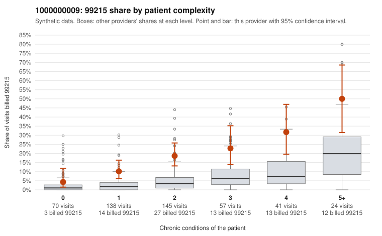

# 1000000009: Provider 1000000009 bills 99215 well above expectation in every complexity stratum, but the few documented 99215 charts all support the billed level, so the pattern is unresolved.

**Leaning (advisory):** Inconclusive

## Why

1000000009 billed 99215 on 17.3% of 475 claims against an expected 3.6% given patient complexity (risk-adjusted score 5.79; plain z-score vs peers 2.05). 21% of this provider's 99215 claims were on patients with 0 or 1 chronic conditions. Records came back for 30 claims. Of 6 documented 99215 claims, 0 (0%) were documented below the billed level, against 0% for the comparison providers. 3 of 22 notes claiming moderate-or-higher data reviewed had no lab or test line on the claim. The elevation is not confined to sicker patients: in the by-complexity table, this provider's 99215 share exceeds the all-provider share at every condition count, including 0–1-condition visits, and about a fifth of the 99215s fall on low-complexity patients. Sampled examples such as C0004380 (upper respiratory infection, no chronic conditions) and C0004477 (hypertension only) illustrate this, which points to a provider-level billing habit rather than panel acuity alone. On the other side, none of the 6 documented 99215 claims was documented below the billed level, and even the low-complexity claim C0004639 has high MDM documented. However, 6 charts is too thin to clear the provider. The 3 notes claiming moderate-or-higher data reviewed with no lab or test line on the claim are a weak signal that some notes may be templated or inflated, not proof. A reviewer should first request charts for the low-complexity 99215 claims (for example C0004380, C0004529 and C0004623), look for cloned MDM language across notes, and check whether the recorded minutes back up the visits where time is missing. Examples: C0004265: billed 99215, patient aged 65 with 1 chronic condition(s) (osteoarthritis). C0004300: billed 99215, patient aged 58 with 1 chronic condition(s) (hyperlipidemia).

## Evidence chart

## Cited claims

`C0004265`, `C0004300`

## Suggested next steps

- Request records for a larger sample of this provider's 99214 and 99215 claims; what came back is too thin to judge.
- Re-screen the provider once the records arrive.

---
Citations checked: 2/2 valid. Synthetic data. The leaning is advisory; the flag comes from the statistical screen, and no clinical documentation is available beyond the sampled records-review facts shown in the packet.
