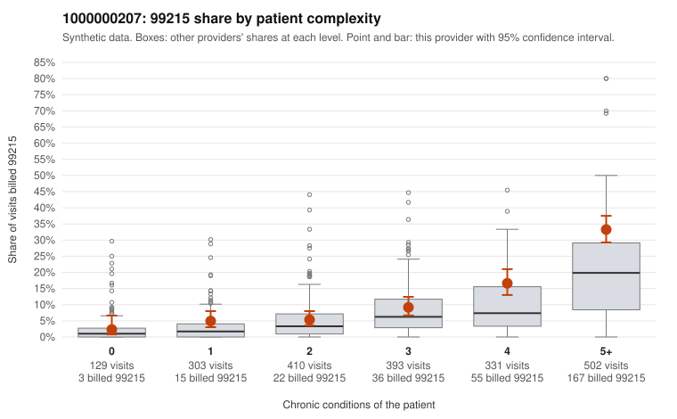

# 1000000207: Provider 1000000207's elevated 99215 rate falls mostly on complex patients but exceeds peers at every complexity level, and too few charts were returned to tell upcoding from a sicker panel.

**Leaning (advisory):** Inconclusive

## Why

1000000207 billed 99215 on 14.4% of 2,068 claims against an expected 6.5% given patient complexity (risk-adjusted score 5.25; plain z-score vs peers 1.57). 6% of this provider's 99215 claims were on patients with 0 or 1 chronic conditions. Records came back for 30 claims. Of 2 documented 99215 claims, 0 (0%) were documented below the billed level, against 0% for the comparison providers. 2 of 24 notes claiming moderate-or-higher data reviewed had no lab or test line on the claim. Most of this provider's 99215 claims are on patients with multiple chronic conditions, which fits a complex panel. But the 99215 share runs above the all-provider rate in every complexity stratum, most sharply at 4 and 5+ conditions, so patient mix alone does not fully explain the excess. The billing is also heavily weighted toward 99214, which the risk-adjusted 99215 comparison does not capture. Documentation is too thin to judge: only two 99215 charts came back, and both supported the billed level (C0097765, C0098700). The 99214 mismatch rate looks higher than peers, but it rests on just two claims (C0098108, C0098954), and the two notes claiming moderate-or-higher data reviewed with no lab line on the claim are only weak signals. A reviewer should first request a larger chart sample focused on 99215 and 99214. Start with the sampled low-complexity 99215 claims that carry only acute or symptom codes, such as C0097919, C0098462 and C0099016, and check whether the notes show high-level medical decision making (MDM) or documented time. Examples: C0098108: billed 99214; documented MDM level low, minutes not recorded. C0098954: billed 99214; documented MDM level low, minutes not recorded. C0097014: billed 99215, patient aged 76 with 1 chronic condition(s) (hypertension). C0097275: billed 99215, patient aged 54 with 1 chronic condition(s) (hypertension).

## Evidence chart

## Cited claims

`C0098108`, `C0098954`, `C0097014`, `C0097275`

## Suggested next steps

- Request records for a larger sample of this provider's 99214 and 99215 claims; what came back is too thin to judge.
- Re-screen the provider once the records arrive.

---
Citations checked: 4/4 valid. Synthetic data. The leaning is advisory; the flag comes from the statistical screen, and no clinical documentation is available beyond the sampled records-review facts shown in the packet.
