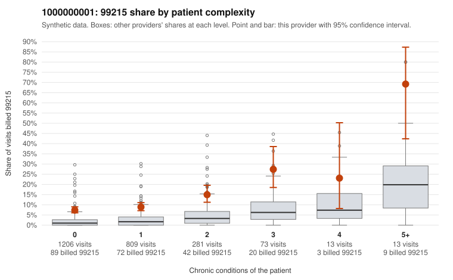

# Payment Integrity dossier: 1000000001

> Draft for human review. Statistical and records-sample evidence only; not a finding. Compliance or legal review is needed before any provider contact, notice or recoupment.

## Provider overview

| | |
|---|---|
| Specialty / state | Family Practice, GA (synthetic) |
| Claims / patients | 2,395 / 1,191 |
| Billed mix (99211 to 99215) | 15 / 11 / 559 / 1,575 / 235 |
| 99215 share | 9.8% |
| Expected 99215 share given patient complexity | 1.8% |
| Screen scores | z vs peers 0.80; risk-adjusted 10.60; flagged by suspicion>=5 |

## Case summary (advisory)

**Provider 1000000001 bills 99215 well above risk-adjusted expectation, mostly on patients with few or no chronic conditions, but the records sample is too thin to confirm or refute this from documentation.**

Leaning: pattern consistent with upcoding. Citations checked: 3/3 valid.

1000000001 billed 99215 on 9.8% of 2,395 claims against an expected 1.8% given patient complexity (risk-adjusted score 10.60; plain z-score vs peers 0.80). 69% of this provider's 99215 claims were on patients with 0 or 1 chronic conditions. Records came back for 30 claims. Of 4 documented 99215 claims, 0 (0%) were documented below the billed level, against 0% for the comparison providers. 1 of 21 notes claiming moderate-or-higher data reviewed had no lab or test line on the claim. The claims pattern points toward upcoding rather than a sicker panel. 99215 use runs above the all-provider share in every complexity stratum, not just among complex patients, and most of this provider's 99215s go to patients with 0 or 1 chronic conditions. Sampled examples include visits for back pain, abdominal pain, urinary infection and follow-up codes (e.g., C0000202, C0000468, C0000713, C0001196). The documentation does not settle the question. Only 4 documented 99215 claims came back, and all were supported at high MDM. One of them, C0000872, is a zero-condition urinary infection visit documented as high MDM at 34 minutes, which deserves a look for possible note inflation or cloning rather than being read as reassurance. The modest peer z-score versus the large risk-adjusted score suggests the concern is the case mix, not raw volume. A reviewer should first request a larger targeted chart sample of low-complexity 99215 claims, starting with those listed, and compare documented problems, data and risk against the diagnoses billed. Examples: C0000096: billed 99215, patient aged 56 with 1 chronic condition(s) (type 2 diabetes). C0000202: billed 99215, patient aged 41 with 0 chronic condition(s). C0000250: billed 99215, patient aged 46 with 0 chronic condition(s).

## Evidence chart

## Records-review sample so far

Documentation is on file for 30 claims (1% of this provider's claims).

| Billed | Documented | Documentation below billed level | Rate | All-provider rate |
|---|---|---|---|---|
| 99213 | 6 | 0 | 0.0% | 4.7% |
| 99214 | 20 | 0 | 0.0% | 2.4% |
| 99215 | 4 | 0 | 0.0% | 0.0% |

## Recommended next steps for Payment Integrity

1. Request records for the sampled claims in `record_request_list.csv` (53 claims across 99215).
2. Review the records against E/M documentation rules and record the supported level for each claim.
3. Run the overpayment estimator on the reviewed sample (`sampling_plan.md` explains how).
4. Notice, appeal rights, recoupment, education or corrective action, and any referral are decisions for the PI team, compliance and counsel. Nothing here drafts those.

Suggested follow-ups from the case summary:

- Request the full records for the cited claims and have a certified coder re-score each against current E/M documentation rules (medical decision making or total time).
- If the re-scoring confirms the pattern, use the sampling plan in the recovery packet to review a statistical sample of this provider's 99215 claims.
- Check whether notes for the cited claims look copied forward, and whether documented minutes repeat from visit to visit.

## Limits

- Synthetic data; no real claims or providers.
- The leaning is advisory. The flag comes from the statistical screen; the summary explains it.
- The records-review sample is partial and was simulated for this project.
- Allowed amounts are GA Family Practice averages from a public CMS file, not this provider's actual payments.
