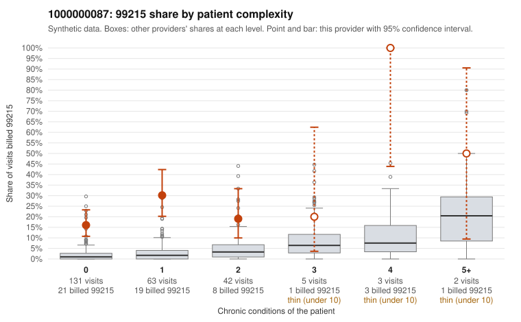

# Payment Integrity dossier: 1000000087

> Draft for human review. Statistical and records-sample evidence only; not a finding. Compliance or legal review is needed before any provider contact, notice or recoupment.

## Provider overview

| | |
|---|---|
| Specialty / state | Family Practice, GA (synthetic) |
| Claims / patients | 246 / 126 |
| Billed mix (99211 to 99215) | 2 / 1 / 57 / 133 / 53 |
| 99215 share | 21.5% |
| Expected 99215 share given patient complexity | 1.9% |
| Screen scores | z vs peers 2.77; risk-adjusted 8.16; flagged by suspicion>=5 |

## Case summary (advisory)

**Provider 1000000087 bills 99215 far above what its largely low-complexity panel would predict, which is consistent with upcoding, but the charts returned so far are too few to confirm or refute it.**

Leaning: pattern consistent with upcoding. Citations checked: 3/3 valid.

1000000087 billed 99215 on 21.5% of 246 claims against an expected 1.9% given patient complexity (risk-adjusted score 8.16; plain z-score vs peers 2.77). 75% of this provider's 99215 claims were on patients with 0 or 1 chronic conditions. Records came back for 30 claims. Of 2 documented 99215 claims, 0 (0%) were documented below the billed level, against 0% for the comparison providers. 3 of 15 notes claiming moderate-or-higher data reviewed had no lab or test line on the claim. The main concern is where the 99215s fall: most are on patients with zero or one chronic condition, and the sampled low-complexity 99215s carry routine diagnoses such as low back pain (C0040080, C0040196), upper respiratory infection (C0040197, C0040288), UTI (C0040145, C0040300) and follow-up visits (C0040183, C0040275), whereas the few high-complexity 99215s (e.g., C0040168, C0040242) look clinically plausible. The documentation does not resolve this: only two 99215 charts came back, and both supported high MDM (C0040182, C0040294). That sample is too thin to judge, and the clean match on the 99213/99214 charts is only mild reassurance. Three notes claimed moderate-or-higher data reviewed with no lab or test line on the claim, which is weak evidence that some notes may be templated or inflated, not proof. A reviewer should first request full records for the low-complexity 99215 claims listed here, checking whether the MDM and time documented for visits like C0040080 and C0040197 reflect the actual encounter or look cloned. The reviewer should then check whether the heavy 99214 volume shows the same pattern. Examples: C0040080: billed 99215, patient aged 46 with 0 chronic condition(s). C0040095: billed 99215, patient aged 43 with 0 chronic condition(s). C0040117: billed 99215, patient aged 57 with 1 chronic condition(s) (chronic kidney disease).

## Evidence chart

## Records-review sample so far

Documentation is on file for 30 claims (12% of this provider's claims).

| Billed | Documented | Documentation below billed level | Rate | All-provider rate |
|---|---|---|---|---|
| 99213 | 11 | 0 | 0.0% | 4.7% |
| 99214 | 16 | 0 | 0.0% | 2.4% |
| 99215 | 2 | 0 | 0.0% | 0.0% |

## Recommended next steps for Payment Integrity

1. Request records for the sampled claims in `record_request_list.csv` (30 claims across 99215).
2. Review the records against E/M documentation rules and record the supported level for each claim.
3. Run the overpayment estimator on the reviewed sample (`sampling_plan.md` explains how).
4. Notice, appeal rights, recoupment, education or corrective action, and any referral are decisions for the PI team, compliance and counsel. Nothing here drafts those.

Suggested follow-ups from the case summary:

- Request the full records for the cited claims and have a certified coder re-score each against current E/M documentation rules (medical decision making or total time).
- If the re-scoring confirms the pattern, use the sampling plan in the recovery packet to review a statistical sample of this provider's 99215 claims.
- Check whether notes for the cited claims look copied forward, and whether documented minutes repeat from visit to visit.

## Limits

- Synthetic data; no real claims or providers.
- The leaning is advisory. The flag comes from the statistical screen; the summary explains it.
- The records-review sample is partial and was simulated for this project.
- Allowed amounts are GA Family Practice averages from a public CMS file, not this provider's actual payments.
