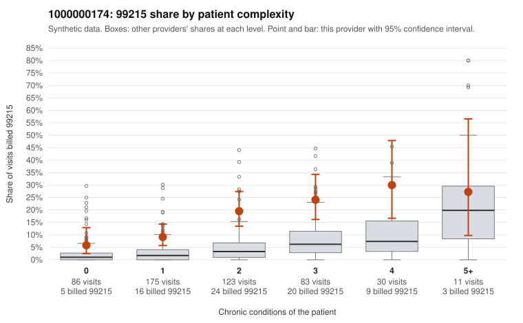

# 1000000174: Provider 1000000174 bills 99215 at several times the expected rate in every complexity tier, but the limited records returned mostly support the billed level, so the pattern is unresolved.

**Leaning (advisory):** Inconclusive

## Why

1000000174 billed 99215 on 15.2% of 508 claims against an expected 3.1% given patient complexity (risk-adjusted score 5.62; plain z-score vs peers 1.70). 27% of this provider's 99215 claims were on patients with 0 or 1 chronic conditions. Records came back for 45 claims. Of 19 documented 99215 claims, 2 (10%) were documented below the billed level, against 0% for the comparison providers. Note checks on 45 returned notes (share showing each sign): problems 20%, late 0%, unsigned 0%, data 4%. No audit trail was received. 6 of 35 notes claiming moderate-or-higher data reviewed had no lab or test line on the claim. The excess 99215 billing is not confined to sicker patients: the by-complexity table shows the provider's 99215 share running roughly three times the all-provider share even for patients with 0 or 1 conditions (e.g., C0081769, C0081968, C0082077), and the coding mix is also heavily weighted toward 99214, which is consistent with upward drift rather than a uniquely complex panel. Against that, most of the 19 documented 99215 claims were supported at high MDM, including low-complexity claim C0082074, and the 2 unsupported claims (C0082021, C0082040) are too few to separate from documentation noise, though they exceed the comparison rate. The documentation may not be fully reliable: 6 notes claiming moderate-or-higher data reviewed have no lab or test on the claim, the repeated-time and problem-list signals are present, and without an audit trail cloned or templated notes cannot be ruled out. A reviewer should first pull additional charts for the low-complexity 99215 claims listed in the packet, especially repeat patients such as M0034588, and check whether their MDM narratives are patient-specific rather than templated. Examples: C0082021: billed 99215; documented MDM level moderate, minutes not recorded. C0082040: billed 99215; documented MDM level moderate, minutes not recorded. C0081769: billed 99215, patient aged 62 with 0 chronic condition(s). C0081787: billed 99215, patient aged 72 with 1 chronic condition(s) (type 2 diabetes).

## Evidence chart

## Cited claims

`C0082021`, `C0082040`, `C0081769`, `C0081787`

## Suggested next steps

- 45 charts came back but do not settle it: request a targeted sample of 99215 charts, starting with C0082021, C0082040, C0081769.
- Re-check after the targeted charts arrive; do not call upcoding or a sicker panel on this evidence alone.

---
Citations checked: 4/4 valid. Synthetic data. The leaning is advisory; the flag comes from the statistical screen, and no clinical documentation is available beyond the sampled records-review facts shown in the packet.
