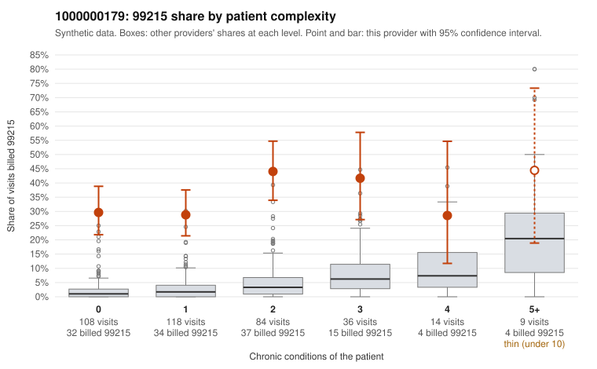

# 1000000179: 1000000179: 0 of 8 documented 99215 claims (0%) are documented below the billed level

**Leaning (advisory):** Pattern consistent with upcoding

## Why

1000000179 billed 99215 on 34.1% of 369 claims against an expected 2.7% given patient complexity (risk-adjusted score 13.50; plain z-score vs peers 4.88). 52% of this provider's 99215 claims were on patients with 0 or 1 chronic conditions. Records came back for 29 claims. Of 8 documented 99215 claims, 0 (0%) were documented below the billed level, against 0% for the comparison providers. Note checks on 29 returned notes (share showing each sign): problems 45%, late 14%, unsigned 0%, data 7%. No audit trail was received. 2 of 23 notes claiming moderate-or-higher data reviewed had no lab or test line on the claim. This pattern is consistent with upcoding. It is a reason to review the records, not a finding. Examples: C0083453: billed 99215, patient aged 56 with 0 chronic condition(s). C0083454: billed 99215, patient aged 41 with 0 chronic condition(s). C0083465: billed 99215, patient aged 64 with 1 chronic condition(s) (hypertension).

## Evidence chart

## Cited claims

`C0083453`, `C0083454`, `C0083465`

## Suggested next steps

- Request the full charts for C0083453, C0083454, C0083465 and have a certified coder re-score each against the current E/M rules (medical decision making or total time).
- If the re-scoring confirms the pattern, review the random sample in the recovery packet's sampling plan before any overpayment estimate; do not extrapolate from a targeted sample.
- Look at the notes themselves: 45% address fewer problems than their level implies and 14% were signed late; request the audit trail for C0083453, C0083454, C0083465.

---
Citations checked: 3/3 valid. Synthetic data. The leaning is advisory; the flag comes from the statistical screen, and no clinical documentation is available beyond the sampled records-review facts shown in the packet.
