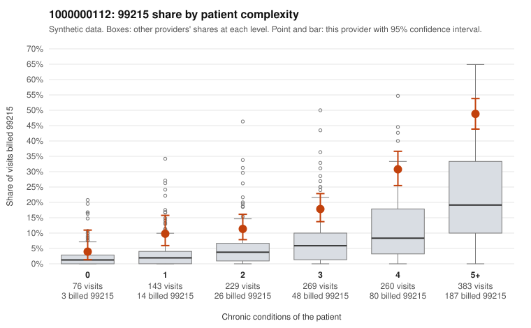

# 1000000112: Provider 1000000112's 99215 rate is elevated across every complexity tier, but the small set of returned charts supports the billed levels, so the evidence does not yet separate upcoding from a sicker panel.

**Leaning (advisory):** Inconclusive

## Why

1000000112 billed 99215 on 26.3% of 1,360 claims against an expected 8.6% given patient complexity (risk-adjusted score 7.75; plain z-score vs peers 3.30). 5% of this provider's 99215 claims were on patients with 0 or 1 chronic conditions. Records came back for 30 claims. Of 11 documented 99215 claims, 0 (0%) were documented below the billed level, against 15% for the comparison providers. Note checks on 30 returned notes (share showing each sign): problems 3%, late 3%, unsigned 0%, data 0%. No audit trail was received. 1 of 20 notes claiming moderate-or-higher data reviewed had no lab or test line on the claim. The 99215 share runs roughly double the all-provider share in every condition-count tier, including 5+ conditions, so panel complexity alone does not explain the excess. Only a small fraction of the 99215s fall on 0–1-condition patients. Against that, all 11 documented 99215s were supported, including C0062129 (a single-condition hypertension patient documented at high MDM), and the note checks are mostly clean. The documentation, though, covers about 2% of claims and cannot settle a pattern this large. Two cautions apply: the 99214 below-billed rate (C0063394, C0063490, both low MDM with no time recorded) is above the peer rate, and about a fifth of notes show repeated visit times. That repeated-time pattern, with no audit trail received, leaves open templated or cloned notes that could make documentation simply match billing. A reviewer should first request a larger chart sample weighted toward 99215s on low-complexity patients (for example C0062089, C0063125 and C0063236), and obtain audit trails to test whether the time and MDM entries reflect actual visit work. Examples: C0063394: billed 99214; documented MDM level low, minutes not recorded. C0063490: billed 99214; documented MDM level low, minutes not recorded. C0062089: billed 99215, patient aged 22 with 0 chronic condition(s). C0062125: billed 99215, patient aged 67 with 1 chronic condition(s) (atrial fibrillation).

## Evidence chart

## Cited claims

`C0063394`, `C0063490`, `C0062089`, `C0062125`

## Suggested next steps

- 30 charts came back but do not settle it: request a targeted sample of 99215 charts, starting with C0063394, C0063490, C0062089.
- Re-check after the targeted charts arrive; do not call upcoding or a sicker panel on this evidence alone.

---
Citations checked: 4/4 valid. Synthetic data. The leaning is advisory; the flag comes from the statistical screen, and no clinical documentation is available beyond the sampled records-review facts shown in the packet.
