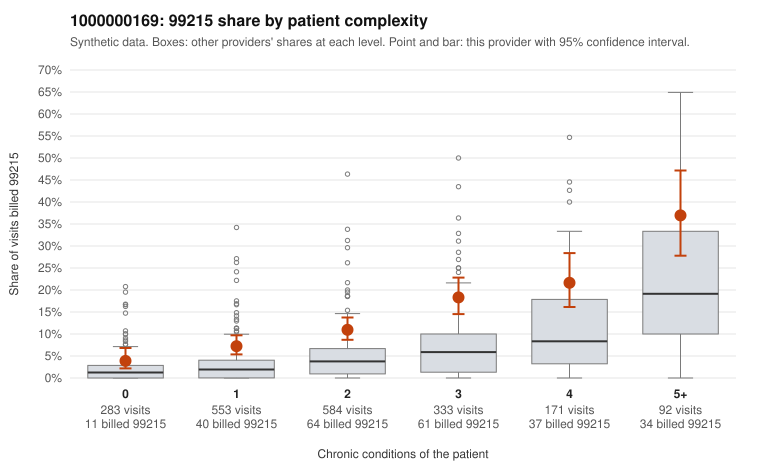

# 1000000169: Provider 1000000169 bills 99215 at about three times the complexity-adjusted expectation, and its returned charts support the billed levels, but heavy note duplication leaves open whether that documentation reflects the actual visits.

**Leaning (advisory):** Inconclusive

## Why

1000000169 billed 99215 on 12.3% of 2,016 claims against an expected 4.0% given patient complexity (risk-adjusted score 6.27; plain z-score vs peers 1.07). 21% of this provider's 99215 claims were on patients with 0 or 1 chronic conditions. Records came back for 45 claims. Of 17 documented 99215 claims, 0 (0%) were documented below the billed level, against 15% for the comparison providers. Note checks on 45 returned notes (share showing each sign): problems 9%, late 2%, unsigned 0%, data 2%. No audit trail was received. 4 of 34 notes claiming moderate-or-higher data reviewed had no lab or test line on the claim. The excess is not explained by a sicker panel: the 99215 share is roughly double the all-provider rate in every complexity band, including 0–1 condition patients. Sampled examples include single-diagnosis visits such as C0096163 and C0096213 (N39.0) and C0096299 (R21), and 99214 also dominates the overall mix. Against that, all 17 documented 99215 claims were supported at high MDM. The usual all-provider unsupported rate is 15%, so a 0% rate would normally point toward a legitimately complex practice. That reassurance is weakened because records cover only about 2% of claims and 49% of returned notes were flagged as duplicates, with a 13% repeated-time rate. This suggests possible templated or cloned notes that would match the billed level regardless of what happened, and the 4 moderate-plus data notes without a lab line point the same way, though weakly. A reviewer should first compare the duplicate-flagged notes side by side and request the EHR audit trail, which was not received. They should then pull charts for the low-complexity 99215 claims listed in the packet to see whether the documented MDM is specific to each encounter. Examples: C0096163: billed 99215, patient aged 33 with 0 chronic condition(s). C0096213: billed 99215, patient aged 23 with 0 chronic condition(s).

## Evidence chart

## Cited claims

`C0096163`, `C0096213`

## Suggested next steps

- 45 charts came back but do not settle it: request a targeted sample of 99215 charts, starting with C0096163, C0096213.
- Re-check after the targeted charts arrive; do not call upcoding or a sicker panel on this evidence alone.

---
Citations checked: 2/2 valid. Synthetic data. The leaning is advisory; the flag comes from the statistical screen, and no clinical documentation is available beyond the sampled records-review facts shown in the packet.
