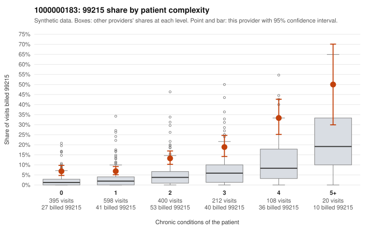

# 1000000183: Provider 1000000183 bills 99215 well above expectation in every complexity stratum, including visits for patients with no chronic conditions, but the few charts returned support the billed 99215s, so documentation is too thin to settle the question.

**Leaning (advisory):** Inconclusive

## Why

1000000183 billed 99215 on 11.9% of 1,733 claims against an expected 3.0% given patient complexity (risk-adjusted score 7.17; plain z-score vs peers 1.02). 33% of this provider's 99215 claims were on patients with 0 or 1 chronic conditions. Records came back for 30 claims. Of 8 documented 99215 claims, 0 (0%) were documented below the billed level, against 15% for the comparison providers. Note checks on 30 returned notes (share showing each sign): problems 13%, late 0%, unsigned 0%, data 3%. No audit trail was received. 2 of 20 notes claiming moderate-or-higher data reviewed had no lab or test line on the claim. The claims pattern is the main concern. The 99215 share runs roughly two to three times the all-provider rate at every complexity level, not just among sicker patients. A third of the 99215s fall on patients with 0–1 conditions, often for simple diagnoses such as back pain, rash or a follow-up code (e.g., C0107257, C0107609, C0107790, C0107751), which is consistent with upcoding rather than a uniformly sicker panel. Against that, all 8 documented 99215s were supported at high MDM (e.g., C0107420, C0108663). But records exist for under 2% of claims, 8 charts cannot rule out a 4x excess, and the note signals give some reason for caution: a 13% problem-flag rate, repeated time entries, no audit trail, and 2 data-heavy notes with no lab or test line on the claim. Together these are weak signs that notes may be templated to match the billed level, not proof. A reviewer should first request charts specifically for the sampled low-complexity 99215 claims listed above and obtain the EHR audit trail, then examine flagged notes C0107449, C0107475, C0108428 and C0107941 for cloned or inflated content. Examples: C0107874: billed 99213; documented MDM level straightforward, minutes not recorded. C0108507: billed 99213; documented MDM level straightforward, 19 minutes. C0107229: billed 99215, patient aged 47 with 0 chronic condition(s). C0107253: billed 99215, patient aged 65 with 1 chronic condition(s) (hypertension).

## Evidence chart

## Cited claims

`C0107874`, `C0108507`, `C0107229`, `C0107253`

## Suggested next steps

- 30 charts came back but do not settle it: request a targeted sample of 99215 charts, starting with C0107874, C0108507, C0107229.
- Re-check after the targeted charts arrive; do not call upcoding or a sicker panel on this evidence alone.

---
Citations checked: 4/4 valid. Synthetic data. The leaning is advisory; the flag comes from the statistical screen, and no clinical documentation is available beyond the sampled records-review facts shown in the packet.
