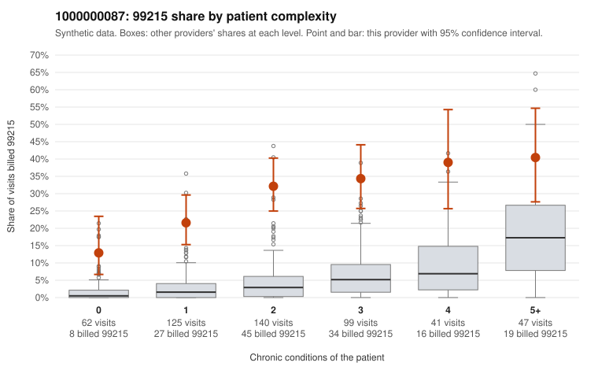

# 1000000087: Provider 1000000087 bills 99215 far above expectation in every complexity tier, including patients with no chronic conditions, but the few charts returned support the billed level, so documentation is too thin to settle the question.

**Leaning (advisory):** Inconclusive

## Why

1000000087 billed 99215 on 29.0% of 514 claims against an expected 3.5% given patient complexity (risk-adjusted score 10.02; plain z-score vs peers 4.05). 23% of this provider's 99215 claims were on patients with 0 or 1 chronic conditions. Records came back for 30 claims. Of 5 documented 99215 claims, 0 (0%) were documented below the billed level, against 0% for the comparison providers. 8 of 26 notes claiming moderate-or-higher data reviewed had no lab or test line on the claim. The claims pattern is concerning because the 99215 excess is not confined to sicker patients. The provider's 99215 share exceeds the all-provider share in every complexity tier, most sharply among 0–1 condition patients. The sampled low-complexity 99215s are mostly single acute or routine diagnoses, such as URI only (C0053883), UTI (C0053613, C0053820), rash (C0053643), low back pain (C0053739, C0053981) and follow-up (C0053743), which rarely warrant high-complexity MDM. Against that, all 5 documented 99215 claims were supported, including C0053974 on a 4-condition patient, but 5 charts are far too few to judge. The 8 notes claiming moderate-or-higher data review with no lab or test line on the claim are weak evidence that notes may be templated or inflated, not proof. A reviewer should first request charts for the sampled low-complexity 99215 claims, especially the acute-only diagnoses listed above, and check whether the MDM and time in those notes are claim-specific or cloned across visits. Examples: C0053573: billed 99215, patient aged 42 with 1 chronic condition(s) (obesity). C0053613: billed 99215, patient aged 55 with 0 chronic condition(s).

## Evidence chart

## Cited claims

`C0053573`, `C0053613`

## Suggested next steps

- Request records for a larger sample of this provider's 99214 and 99215 claims; what came back is too thin to judge.
- Re-screen the provider once the records arrive.

---
Citations checked: 2/2 valid. Synthetic data. The leaning is advisory; the flag comes from the statistical screen, and no clinical documentation is available beyond the sampled records-review facts shown in the packet.
