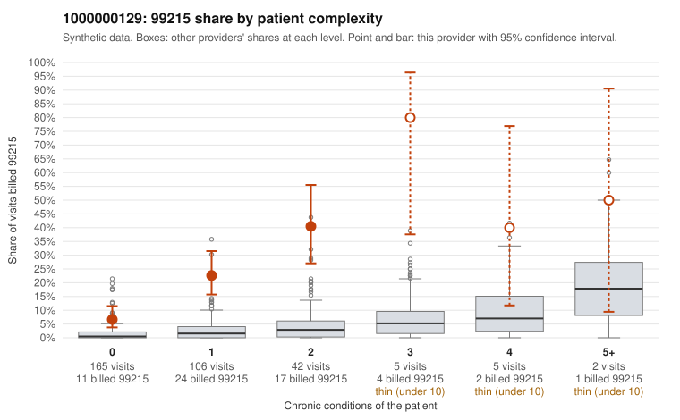

# 1000000129: Provider 1000000129 bills 99215 far above what its patient complexity predicts, mostly on patients with few chronic conditions, yet the small documented sample supports every 99215 reviewed.

**Leaning (advisory):** Inconclusive

## Why

1000000129 billed 99215 on 18.2% of 325 claims against an expected 1.5% given patient complexity (risk-adjusted score 7.93; plain z-score vs peers 2.22). 59% of this provider's 99215 claims were on patients with 0 or 1 chronic conditions. Records came back for 30 claims. Of 10 documented 99215 claims, 0 (0%) were documented below the billed level, against 0% for the comparison providers. 2 of 23 notes claiming moderate-or-higher data reviewed had no lab or test line on the claim. The claims pattern leans toward upcoding: the 99215 share runs well above the all-provider rate in every complexity tier, and most 99215s fall on 0–1 condition patients, with sampled claims for minor or follow-up diagnoses such as rash (C0081138, C0081278), upper respiratory infection (C0081334) and aftercare (C0080993). Against that, all 10 documented 99215 claims were supported, including low-complexity C0080995 (osteoarthritis, high MDM at 45 minutes), so the records as written do not show unsupported billing. The documentation is thin, covering only about a sixth of the 99215s, and a note recording high MDM for a single stable condition could be accurate or could be templated to match the bill. The data-reviewed signal is weak, with only 2 notes lacking a lab or test line. A reviewer should first pull full charts for the low-complexity 99215s, especially symptom-only visits, and read the notes for cloned or boilerplate MDM language and for time statements that are not plausible for the visit. Examples: C0081031: billed 99214; documented MDM level low, 20 minutes. C0080993: billed 99215, patient aged 18 with 0 chronic condition(s). C0080995: billed 99215, patient aged 32 with 1 chronic condition(s) (osteoarthritis); documented MDM level high, 45 minutes.

## Evidence chart

## Cited claims

`C0081031`, `C0080993`, `C0080995`

## Suggested next steps

- Request records for a larger sample of this provider's 99214 and 99215 claims; what came back is too thin to judge.
- Re-screen the provider once the records arrive.

---
Citations checked: 3/3 valid. Synthetic data. The leaning is advisory; the flag comes from the statistical screen, and no clinical documentation is available beyond the sampled records-review facts shown in the packet.
