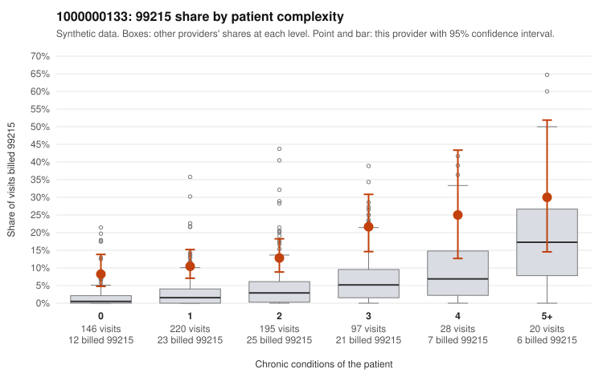

# 1000000133: Provider 1000000133 bills 99215 above expectation in every complexity band, including patients with no chronic conditions, but the few documented 99215 charts all support the billed level, so the evidence cannot yet separate upcoding from a complex panel.

**Leaning (advisory):** Inconclusive

## Why

1000000133 billed 99215 on 13.3% of 706 claims against an expected 2.5% given patient complexity (risk-adjusted score 5.83; plain z-score vs peers 1.41). 37% of this provider's 99215 claims were on patients with 0 or 1 chronic conditions. Records came back for 30 claims. Of 5 documented 99215 claims, 0 (0%) were documented below the billed level, against 0% for the comparison providers. 0 of 22 notes claiming moderate-or-higher data reviewed had no lab or test line on the claim. The billing pattern leans toward concern: the 99215 share runs several times the all-provider rate in every complexity stratum, and the gap is widest relative to peers among 0–1 condition patients. Sampled low-complexity 99215s (e.g., C0081763, C0082120, C0082449) carry simple diagnoses like abdominal pain, back pain or UTI. Against that, the records review found all 5 documented 99215s supported, including low-complexity claims C0081873, C0082044 and C0082079 charted at high MDM, and there is no cloned-data signal because every moderate-plus data-reviewed note had a lab or test on the claim. Five charts are too few to judge, and the 2 low-MDM 99214s (C0082092, C0082164) are a small, noisy signal rather than a pattern. A reviewer should first request more charts, prioritizing 99215s on 0–1 condition patients, and check whether the high-MDM notes on acute, single-complaint visits describe genuinely complex workups or templated language. Examples: C0082092: billed 99214; documented MDM level low, minutes not recorded. C0082164: billed 99214; documented MDM level low, minutes not recorded. C0081749: billed 99215, patient aged 42 with 1 chronic condition(s) (type 2 diabetes). C0081763: billed 99215, patient aged 38 with 0 chronic condition(s).

## Evidence chart

## Cited claims

`C0082092`, `C0082164`, `C0081749`, `C0081763`

## Suggested next steps

- Request records for a larger sample of this provider's 99214 and 99215 claims; what came back is too thin to judge.
- Re-screen the provider once the records arrive.

---
Citations checked: 4/4 valid. Synthetic data. The leaning is advisory; the flag comes from the statistical screen, and no clinical documentation is available beyond the sampled records-review facts shown in the packet.
