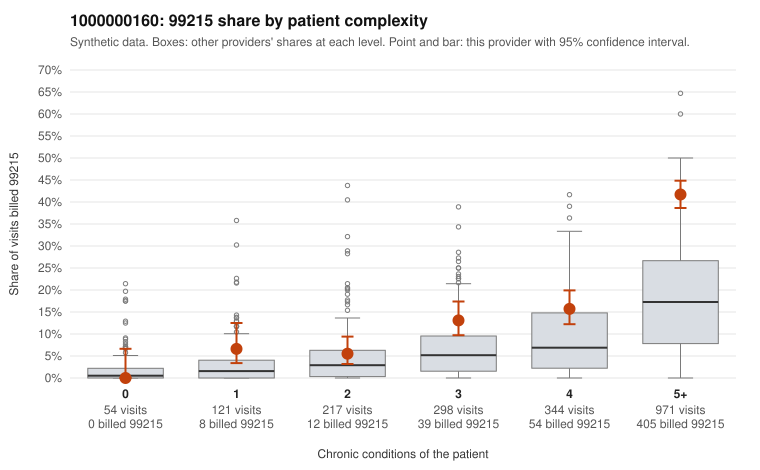

# 1000000160: Provider 1000000160 bills 99215 well above its risk-adjusted expectation in every complexity band, but the elevation is concentrated in multimorbid patients and the few returned charts support the billed levels, so the pattern is unresolved.

**Leaning (advisory):** Inconclusive

## Why

1000000160 billed 99215 on 25.8% of 2,005 claims against an expected 8.1% given patient complexity (risk-adjusted score 9.35; plain z-score vs peers 3.52). 2% of this provider's 99215 claims were on patients with 0 or 1 chronic conditions. Records came back for 30 claims. Of 7 documented 99215 claims, 0 (0%) were documented below the billed level, against 0% for the comparison providers. Note checks on 30 returned notes (share showing each sign): problems 0%, late 10%, unsigned 0%, data 3%. No audit trail was received. 1 of 20 notes claiming moderate-or-higher data reviewed had no lab or test line on the claim. Most of this provider's 99215 volume falls on patients with 5+ conditions, which points toward a sicker panel. Even so, the 99215 share runs above the all-provider share in every complexity band, so panel acuity alone does not explain the risk-adjusted excess. The heavy 99214 concentration in the mix adds to that concern. The documented 99215 claims are all supported at high MDM (e.g., C0094571, C0095218), but only 7 were reviewed and records came back for a very small share of claims, so the documentation is too thin to clear or confirm the pattern. The note signals are modest rather than damning: some late notes (C0095109, C0095218, C0096482), some repeated visit times, and one moderate-plus data claim without a lab line (C0095714). No audit trail was received, so cloned or templated notes cannot be ruled out. A reviewer should first request a larger, targeted chart sample of 99215 claims, including sampled low-condition cases such as C0094968 and C0096409. They should also obtain the audit trail to check note creation timing and copy-forward. Examples: C0094498: billed 99215, patient aged 56 with 1 chronic condition(s) (osteoarthritis). C0094832: billed 99215, patient aged 38 with 1 chronic condition(s) (osteoarthritis).

## Evidence chart

## Cited claims

`C0094498`, `C0094832`

## Suggested next steps

- 30 charts came back but do not settle it: request a targeted sample of 99215 charts, starting with C0094498, C0094832.
- Re-check after the targeted charts arrive; do not call upcoding or a sicker panel on this evidence alone.

---
Citations checked: 2/2 valid. Synthetic data. The leaning is advisory; the flag comes from the statistical screen, and no clinical documentation is available beyond the sampled records-review facts shown in the packet.
