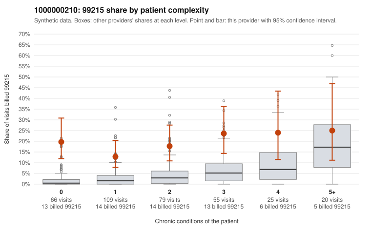

# 1000000210: 1000000210: 11 of 17 documented 99215 claims (65%) are documented below the billed level

**Leaning (advisory):** Pattern consistent with upcoding

## Why

1000000210 billed 99215 on 18.4% of 354 claims against an expected 2.9% given patient complexity (risk-adjusted score 5.40; plain z-score vs peers 2.26). 42% of this provider's 99215 claims were on patients with 0 or 1 chronic conditions. Records came back for 45 claims. Of 17 documented 99215 claims, 11 (65%) were documented below the billed level, against 0% for the comparison providers. Note checks on 45 returned notes (share showing each sign): problems 11%, late 7%, unsigned 0%, data 0%. No audit trail was received. 0 of 30 notes claiming moderate-or-higher data reviewed had no lab or test line on the claim. This pattern is consistent with upcoding. It is a reason to review the records, not a finding. Examples: C0114814: billed 99215; documented MDM level moderate, minutes not recorded. C0114825: billed 99215; documented MDM level moderate, 38 minutes. C0114882: billed 99215, patient aged 77 with 0 chronic condition(s); documented MDM level moderate, 38 minutes. C0114756: billed 99215, patient aged 42 with 0 chronic condition(s). C0114760: billed 99215, patient aged 25 with 0 chronic condition(s). C0114767: billed 99215, patient aged 56 with 1 chronic condition(s) (type 2 diabetes).

## Evidence chart

## Cited claims

`C0114814`, `C0114825`, `C0114882`, `C0114756`, `C0114760`, `C0114767`

## Suggested next steps

- Request the full charts for C0114814, C0114825, C0114882 and have a certified coder re-score each against the current E/M rules (medical decision making or total time).
- If the re-scoring confirms the pattern, review the random sample in the recovery packet's sampling plan before any overpayment estimate; do not extrapolate from a targeted sample.
- Look at the notes themselves: 11% address fewer problems than their level implies and 7% were signed late; request the audit trail for C0114814, C0114825, C0114882.

---
Citations checked: 6/6 valid. Synthetic data. The leaning is advisory; the flag comes from the statistical screen, and no clinical documentation is available beyond the sampled records-review facts shown in the packet.
