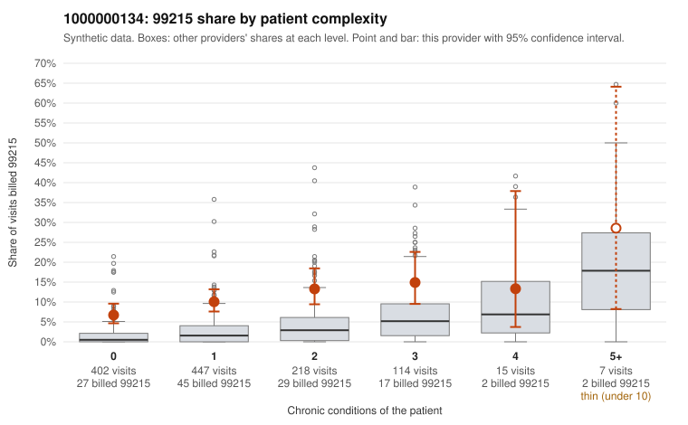

# Payment Integrity dossier: 1000000134

> Draft for human review. Statistical and records-sample evidence only; not a finding. Compliance or legal review is needed before any provider contact, notice or recoupment.

## Provider overview

| | |
|---|---|
| Specialty / state | Family Practice, GA (synthetic) |
| Claims / patients | 1,203 / 580 |
| Billed mix (99211 to 99215) | 14 / 18 / 462 / 587 / 122 |
| 99215 share | 10.1% |
| Expected 99215 share given patient complexity | 1.8% |
| Screen scores | z vs peers 0.87; risk-adjusted 6.80; flagged by suspicion>=5 |

## Case summary (advisory)

**1000000134: 1 of 18 documented 99215 claims (6%) are documented below the billed level**

Leaning: pattern consistent with upcoding. Citations checked: 4/4 valid.

1000000134 billed 99215 on 10.1% of 1,203 claims against an expected 1.8% given patient complexity (risk-adjusted score 6.80; plain z-score vs peers 0.87). 59% of this provider's 99215 claims were on patients with 0 or 1 chronic conditions. Records came back for 45 claims. Of 18 documented 99215 claims, 1 (6%) were documented below the billed level, against 0% for the comparison providers. Note checks on 45 returned notes (share showing each sign): problems 36%, late 16%, unsigned 0%, data 9%, bulk created 0%, paste heavy 0%. 5 of 31 notes claiming moderate-or-higher data reviewed had no lab or test line on the claim. This pattern is consistent with upcoding. It is a reason to review the records, not a finding. Examples: C0083420: billed 99215, patient aged 60 with 1 chronic condition(s) (type 2 diabetes); documented MDM level moderate, minutes not recorded. C0082480: billed 99215, patient aged 57 with 1 chronic condition(s) (chronic kidney disease). C0082546: billed 99215, patient aged 53 with 0 chronic condition(s). C0082553: billed 99215, patient aged 58 with 0 chronic condition(s).

## Evidence chart

## Records-review sample so far

Documentation is on file for 45 claims (4% of this provider's claims).

| Billed | Documented | Documentation below billed level | Rate | All-provider rate |
|---|---|---|---|---|
| 99213 | 10 | 1 | 10.0% | 1.6% |
| 99214 | 16 | 0 | 0.0% | 3.3% |
| 99215 | 18 | 1 | 5.6% | 0.0% |

## Recommended next steps for Payment Integrity

1. Request records for the sampled claims in `record_request_list.csv` (44 claims across 99215).
2. Review the records against E/M documentation rules and record the supported level for each claim.
3. Run the overpayment estimator on the reviewed sample (`sampling_plan.md` explains how).
4. Notice, appeal rights, recoupment, education or corrective action, and any referral are decisions for the PI team, compliance and counsel. Nothing here drafts those.

Suggested follow-ups from the case summary:

- Request the full charts for C0083420, C0082480, C0082546 and have a certified coder re-score each against the current E/M rules (medical decision making or total time).
- If the re-scoring confirms the pattern, review the random sample in the recovery packet's sampling plan before any overpayment estimate; do not extrapolate from a targeted sample.
- Look at the notes themselves: 36% address fewer problems than their level implies and 16% were signed late; request the audit trail for C0083420, C0082480, C0082546.

## Limits

- Synthetic data; no real claims or providers.
- The leaning is advisory. The flag comes from the statistical screen; the summary explains it.
- The records-review sample is partial and was simulated for this project.
- Allowed amounts are GA Family Practice averages from a public CMS file, not this provider's actual payments.
