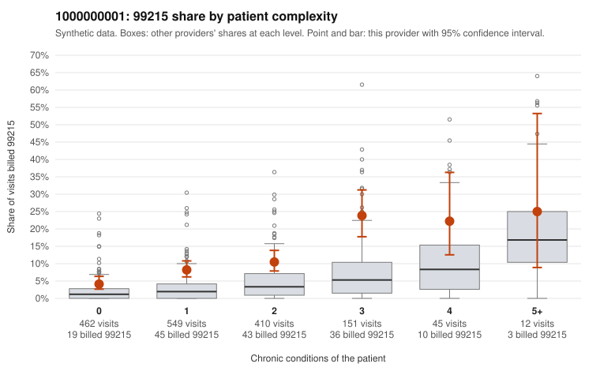

# 1000000001: Provider 1000000001 bills 99215 well above its risk-adjusted expectation, with a large share on low-complexity patients, but documentation is too thin to confirm or refute upcoding.

**Leaning (advisory):** Inconclusive

## Why

1000000001 billed 99215 on 9.6% of 1,629 claims against an expected 2.6% given patient complexity (risk-adjusted score 6.15; plain z-score vs peers 0.90). 41% of this provider's 99215 claims were on patients with 0 or 1 chronic conditions. Records came back for 30 claims. Of 2 documented 99215 claims, 0 (0%) were documented below the billed level, against 8% for the comparison providers. 3 of 16 notes claiming moderate-or-higher data reviewed had no lab or test line on the claim. The risk-adjusted excess holds in every complexity band, and the sampled low-complexity 99215 claims are on routine presentations. Examples include isolated back pain (C0000332, C0000372, C0000574), urinary tract infection (C0000519, C0001539), follow-up visits (C0000309, C0001134) and upper respiratory infection (C0001605). That pattern is consistent with upcoding rather than a sicker panel, though sampled high-complexity 99215 claims such as C0000715 and C0000756 look appropriate. The records review cannot settle the question: only 2 documented 99215 claims came back, both supported (C0000268, C0000684), which is far too few to judge. The few notes claiming moderate-or-higher data reviewed with no lab or test line on the claim are weak evidence of templated notes, not proof. A reviewer should first request charts for the sampled low-complexity 99215 claims listed above to see whether MDM and time support level 5. Separately, they should check whether notes look cloned across visits. Examples: C0000038: billed 99215, patient aged 38 with 1 chronic condition(s) (obesity). C0000076: billed 99215, patient aged 57 with 1 chronic condition(s) (type 2 diabetes).

## Evidence chart

## Cited claims

`C0000038`, `C0000076`

## Suggested next steps

- Request records for a larger sample of this provider's 99214 and 99215 claims; what came back is too thin to judge.
- Re-screen the provider once the records arrive.

---
Citations checked: 2/2 valid. Synthetic data. The leaning is advisory; the flag comes from the statistical screen, and no clinical documentation is available beyond the sampled records-review facts shown in the packet.
