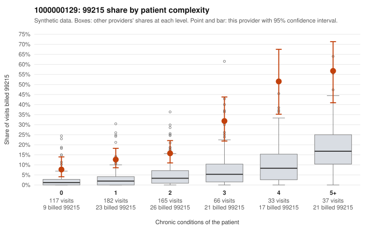

# 1000000129: Provider 1000000129 bills 99215 far above expectation in every complexity tier, but the documented 99215 charts so far support the billed level, so the picture is mixed.

**Leaning (advisory):** Inconclusive

## Why

1000000129 billed 99215 on 19.5% of 600 claims against an expected 3.7% given patient complexity (risk-adjusted score 7.36; plain z-score vs peers 2.80). 27% of this provider's 99215 claims were on patients with 0 or 1 chronic conditions. Records came back for 30 claims. Of 13 documented 99215 claims, 0 (0%) were documented below the billed level, against 8% for the comparison providers. 5 of 26 notes claiming moderate-or-higher data reviewed had no lab or test line on the claim. The excess is not confined to sick patients. The 99215 share runs several times the all-provider rate even among patients with 0 or 1 chronic conditions, and the sampled low-complexity 99215 claims include routine-looking encounters such as follow-up visits (C0057524, C0057567, C0057790), an upper respiratory infection (C0057778) and urinary tract infections (C0057378, C0057647). That pattern is consistent with upcoding rather than a uniformly complex panel. Against that, none of the 13 documented 99215 claims fell below the billed level (examples C0057320, C0057371, C0057758 show high MDM), which points the other way. Two caveats limit how much weight the documentation can carry: 13 charts from a 5% records return is a small base, and the 5 notes claiming moderate-or-higher data review with no lab or test line on the claim are weak evidence that some notes may be templated or inflated. A reviewer should first request charts specifically for the low-complexity 99215 claims listed above. The reviewer should also check whether the 13 documented 99215s were drawn mostly from high-complexity patients, and look for cloned note text across the 5 no-lab notes. Examples: C0057397: billed 99214; documented MDM level low, minutes not recorded. C0057288: billed 99215, patient aged 34 with 1 chronic condition(s) (obesity). C0057378: billed 99215, patient aged 46 with 0 chronic condition(s).

## Evidence chart

## Cited claims

`C0057397`, `C0057288`, `C0057378`

## Suggested next steps

- Request records for a larger sample of this provider's 99214 and 99215 claims; what came back is too thin to judge.
- Re-screen the provider once the records arrive.

---
Citations checked: 3/3 valid. Synthetic data. The leaning is advisory; the flag comes from the statistical screen, and no clinical documentation is available beyond the sampled records-review facts shown in the packet.
