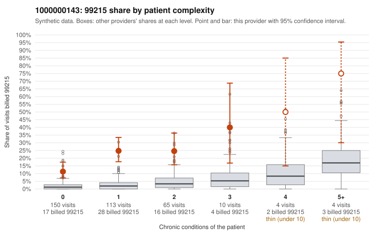

# 1000000143: Provider 1000000143's 99215 share is far above what its largely low-complexity panel predicts, but the small set of returned charts supports the billed level, so the pattern is unresolved.

**Leaning (advisory):** Inconclusive

## Why

1000000143 billed 99215 on 20.2% of 346 claims against an expected 2.2% given patient complexity (risk-adjusted score 8.01; plain z-score vs peers 2.94). 64% of this provider's 99215 claims were on patients with 0 or 1 chronic conditions. Records came back for 30 claims. Of 7 documented 99215 claims, 0 (0%) were documented below the billed level, against 8% for the comparison providers. 3 of 17 notes claiming moderate-or-higher data reviewed had no lab or test line on the claim. The billing pattern points toward upcoding: the 99215 share is elevated in every complexity stratum, and most 99215s fall on patients with zero or one chronic condition, often for simple diagnoses such as back pain, URI, UTI or follow-up codes (e.g., C0068490, C0068599, C0068670). That is not what a legitimately sicker panel would look like. Against this, all seven documented 99215 claims were supported, which is below the all-provider mismatch rate. However, seven charts is too thin to clear the provider, and the documentation itself raises questions: C0068490 is a zero-condition back-pain visit documented as high MDM with no time recorded, and a few notes claiming moderate-or-higher data review have no lab or test line on the claim, which is weak evidence of templated or inflated notes. A reviewer should first request charts for a larger sample of the low-complexity 99215 claims listed here. Those notes should be compared against each other for cloned language and checked to see whether the documented MDM elements (data, risk, problems addressed) are plausible for the diagnoses billed. Examples: C0068510: billed 99213; documented MDM level straightforward, minutes not recorded. C0068790: billed 99214; documented MDM level low, minutes not recorded. C0068472: billed 99215, patient aged 69 with 1 chronic condition(s) (COPD). C0068490: billed 99215, patient aged 43 with 0 chronic condition(s); documented MDM level high, minutes not recorded.

## Evidence chart

## Cited claims

`C0068510`, `C0068790`, `C0068472`, `C0068490`

## Suggested next steps

- Request records for a larger sample of this provider's 99214 and 99215 claims; what came back is too thin to judge.
- Re-screen the provider once the records arrive.

---
Citations checked: 4/4 valid. Synthetic data. The leaning is advisory; the flag comes from the statistical screen, and no clinical documentation is available beyond the sampled records-review facts shown in the packet.
