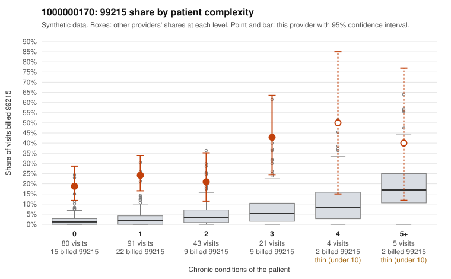

# 1000000170: Provider 1000000170 bills 99215 far above expectation, mostly on low-complexity patients, yet every documented 99215 note supports the billed level, and some of those notes may overstate the work done.

**Leaning (advisory):** Inconclusive

## Why

1000000170 billed 99215 on 24.2% of 244 claims against an expected 2.6% given patient complexity (risk-adjusted score 7.51; plain z-score vs peers 3.69). 63% of this provider's 99215 claims were on patients with 0 or 1 chronic conditions. Records came back for 30 claims. Of 11 documented 99215 claims, 0 (0%) were documented below the billed level, against 8% for the comparison providers. 9 of 26 notes claiming moderate-or-higher data reviewed had no lab or test line on the claim. The billing shape points toward upcoding: the 99215 excess is concentrated on patients with 0 or 1 chronic conditions, with sampled visits for simple problems such as upper respiratory infection (C0082883, C0082963), low back pain (C0082949) and urinary tract infection (C0083004) billed at the top level. The documentation points the other way, since none of the 11 documented 99215 claims fell below the billed level, against a peer rate of about 8%. That support is weaker than it looks: 11 charts is a thin base, and several 'supported' high-MDM notes sit on low-complexity visits (C0082872 for abdominal pain with minutes not recorded, C0083037 for low back pain). The data-reviewed rule hit, where notes claim moderate-or-higher data review on claims with no lab or test line, is weak evidence that notes may be cloned or inflated to match the billed code rather than proof of it. A reviewer should first pull full charts for the low-complexity 99215 claims, starting with C0082872 and C0083037, and check for templated or copied MDM language and whether the claimed data review actually happened, then request more records to widen the documented sample. Examples: C0082819: billed 99215, patient aged 61 with 1 chronic condition(s) (hypertension). C0082837: billed 99215, patient aged 49 with 1 chronic condition(s) (depression).

## Evidence chart

## Cited claims

`C0082819`, `C0082837`

## Suggested next steps

- Request records for a larger sample of this provider's 99214 and 99215 claims; what came back is too thin to judge.
- Re-screen the provider once the records arrive.

---
Citations checked: 2/2 valid. Synthetic data. The leaning is advisory; the flag comes from the statistical screen, and no clinical documentation is available beyond the sampled records-review facts shown in the packet.
