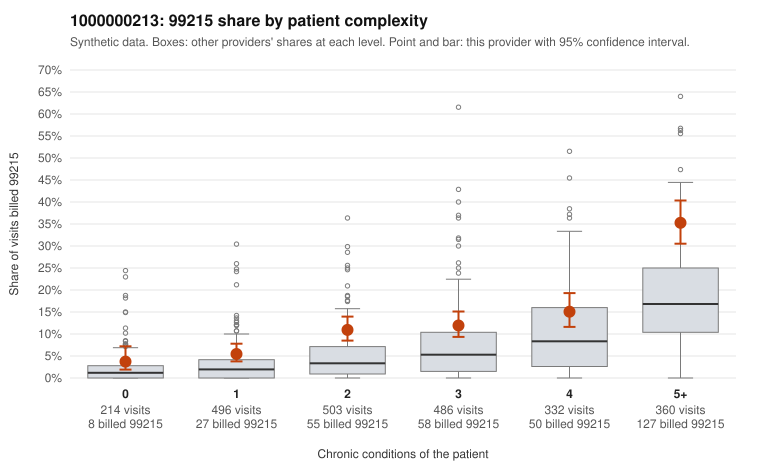

# 1000000213: Provider 1000000213's 99215 rate exceeds expectation in every complexity tier, and a records signal points at 99214 rather than 99215, but documentation is too thin to call the pattern.

**Leaning (advisory):** Inconclusive

## Why

1000000213 billed 99215 on 13.6% of 2,391 claims against an expected 5.6% given patient complexity (risk-adjusted score 6.08; plain z-score vs peers 1.66). 11% of this provider's 99215 claims were on patients with 0 or 1 chronic conditions. Records came back for 30 claims. Of 3 documented 99215 claims, 0 (0%) were documented below the billed level, against 8% for the comparison providers. 3 of 24 notes claiming moderate-or-higher data reviewed had no lab or test line on the claim. The excess 99215 billing is not explained by panel acuity alone. The 99215 share runs above the all-provider share in every condition stratum, including patients with 0 or 1 conditions. Sampled low-complexity 99215 claims include simple acute diagnoses such as upper respiratory infection (C0101606, C0101620) and low back pain (C0103169, C0102869), which is the pattern of concern. The three documented 99215 claims (C0101625, C0102024, C0103491) all support high MDM, but three charts cannot settle the question. The more notable records signal is at 99214, this provider's dominant code: the four below-billed examples (C0102305, C0102424, C0103425, C0103474) all document low MDM with no minutes recorded, an unsupported rate far above peers that suggests level inflation one step down. The few moderate-plus data-reviewed notes without a lab line are only weak evidence of cloned notes. A reviewer should first request charts for the sampled low-complexity 99215 claims and a larger 99214 sample, to see whether the 99214 mismatch holds and whether 99215 support survives beyond three notes. Examples: C0102305: billed 99214; documented MDM level low, minutes not recorded. C0102424: billed 99214; documented MDM level low, minutes not recorded. C0101004: billed 99215, patient aged 47 with 0 chronic condition(s). C0101556: billed 99215, patient aged 77 with 1 chronic condition(s) (chronic kidney disease).

## Evidence chart

## Cited claims

`C0102305`, `C0102424`, `C0101004`, `C0101556`

## Suggested next steps

- Request records for a larger sample of this provider's 99214 and 99215 claims; what came back is too thin to judge.
- Re-screen the provider once the records arrive.

---
Citations checked: 4/4 valid. Synthetic data. The leaning is advisory; the flag comes from the statistical screen, and no clinical documentation is available beyond the sampled records-review facts shown in the packet.
