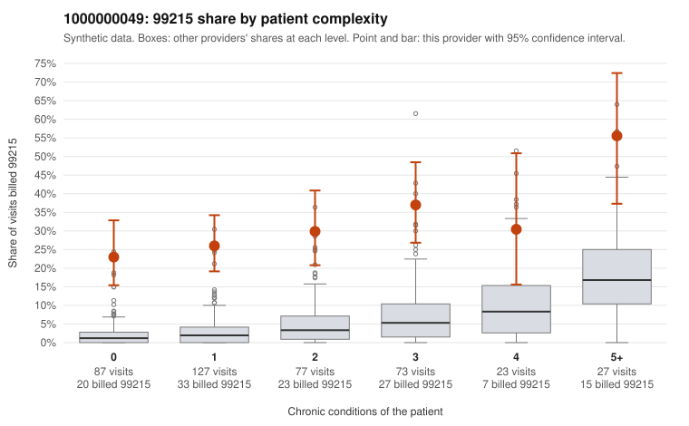

# 1000000049: 1000000049: too few returned records to judge

**Leaning (advisory):** Inconclusive

## Why

1000000049 billed 99215 on 30.2% of 414 claims against an expected 3.8% given patient complexity (risk-adjusted score 10.12; plain z-score vs peers 4.84). 42% of this provider's 99215 claims were on patients with 0 or 1 chronic conditions. Records came back for 0 claims. No documented 99215 claims came back. The evidence does not support a call either way yet. Examples: C0022814: billed 99215, patient aged 68 with 1 chronic condition(s) (type 2 diabetes). C0022827: billed 99215, patient aged 43 with 0 chronic condition(s).

## Evidence chart

## Cited claims

`C0022814`, `C0022827`

## Suggested next steps

- No usable charts yet: request a random sample of 30 charts, then a targeted sample of 99215s for C0022814, C0022827.
- If the practice does not respond, record that non-response is not evidence of upcoding and decide whether the claims signal alone warrants more.

---
Citations checked: 2/2 valid. Synthetic data. The leaning is advisory; the flag comes from the statistical screen, and no clinical documentation is available beyond the sampled records-review facts shown in the packet.
