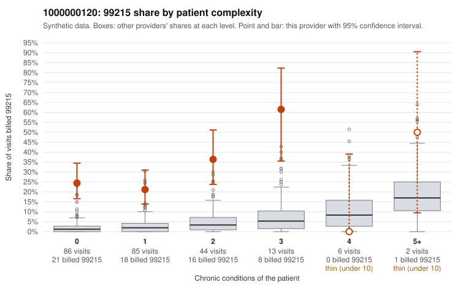

# 1000000120: 1000000120: 8 of 11 documented 99215 claims (73%) are documented below the billed level

**Leaning (advisory):** Pattern consistent with upcoding

## Why

1000000120 billed 99215 on 27.1% of 236 claims against an expected 2.4% given patient complexity (risk-adjusted score 8.80; plain z-score vs peers 4.25). 61% of this provider's 99215 claims were on patients with 0 or 1 chronic conditions. Records came back for 30 claims. Of 11 documented 99215 claims, 8 (73%) were documented below the billed level, against 8% for the comparison providers. Note checks on 30 returned notes (share showing each sign): problems 47%, late 13%, unsigned 0%, data 3%, bulk created 0%, paste heavy 0%. 2 of 18 notes claiming moderate-or-higher data reviewed had no lab or test line on the claim. This pattern is consistent with upcoding. It is a reason to review the records, not a finding. Examples: C0054193: billed 99215; documented MDM level moderate, 37 minutes. C0054211: billed 99215, patient aged 30 with 1 chronic condition(s) (heart failure); documented MDM level moderate, 33 minutes. C0054263: billed 99215, patient aged 42 with 0 chronic condition(s); documented MDM level moderate, minutes not recorded. C0054136: billed 99215, patient aged 44 with 1 chronic condition(s) (heart failure). C0054141: billed 99215, patient aged 62 with 0 chronic condition(s). C0054144: billed 99215, patient aged 37 with 0 chronic condition(s).

## Evidence chart

## Cited claims

`C0054193`, `C0054211`, `C0054263`, `C0054136`, `C0054141`, `C0054144`

## Suggested next steps

- Request the full charts for C0054193, C0054211, C0054263 and have a certified coder re-score each against the current E/M rules (medical decision making or total time).
- If the re-scoring confirms the pattern, review the random sample in the recovery packet's sampling plan before any overpayment estimate; do not extrapolate from a targeted sample.
- Look at the notes themselves: 47% address fewer problems than their level implies and 13% were signed late; request the audit trail for C0054193, C0054211, C0054263.

---
Citations checked: 6/6 valid. Synthetic data. The leaning is advisory; the flag comes from the statistical screen, and no clinical documentation is available beyond the sampled records-review facts shown in the packet.
