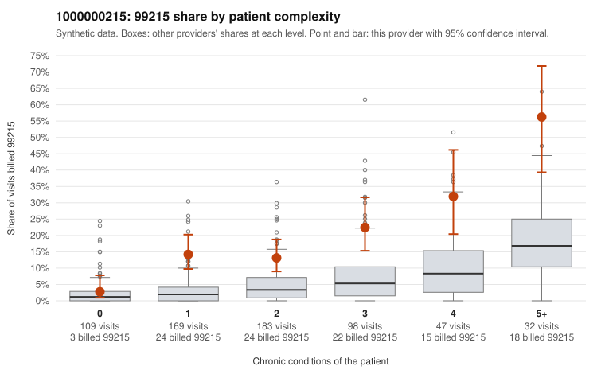

# 1000000215: Provider 1000000215 bills 99215 far above expectation in every complexity band, including one-condition patients. The few returned charts support the billed level, but they are too thin and show possible note-cloning signals, so no conclusion is possible yet.

**Leaning (advisory):** Inconclusive

## Why

1000000215 billed 99215 on 16.6% of 638 claims against an expected 3.8% given patient complexity (risk-adjusted score 6.02; plain z-score vs peers 2.24). 25% of this provider's 99215 claims were on patients with 0 or 1 chronic conditions. Records came back for 30 claims. Of 7 documented 99215 claims, 0 (0%) were documented below the billed level, against 8% for the comparison providers. Note checks on 30 returned notes (share showing each sign): problems 23%, late 7%, unsigned 0%, data 3%. No audit trail was received. 2 of 26 notes claiming moderate-or-higher data reviewed had no lab or test line on the claim. The billing pattern raises concern because the elevation is not limited to complex patients. The 99215 share on one-condition patients runs several times the all-provider rate. Sampled claims such as C0104099 (no chronic conditions, rash diagnosis) and C0103840 (24-year-old with asthma and an upper respiratory infection) look hard to reconcile with high-complexity visits. Against that, every documented 99215 was supported, including C0103927, a multimorbid 80-year-old. However, only 7 documented 99215 claims came back, which is too few to clear the provider. The notes also show cloning-type signals: about a third flagged as duplicates and about a sixth with repeated times, and no audit trail was received to check whether notes were templated or inflated to match the billed code. A reviewer should first request charts for the sampled low-complexity 99215 claims (e.g., C0104099, C0103840, C0103752) along with the EHR audit trail. The reviewer should then compare those notes for copied text and identical time entries before weighing the supported examples. Examples: C0103752: billed 99215, patient aged 39 with 0 chronic condition(s). C0103758: billed 99215, patient aged 41 with 1 chronic condition(s) (hypertension).

## Evidence chart

## Cited claims

`C0103752`, `C0103758`

## Suggested next steps

- 30 charts came back but do not settle it: request a targeted sample of 99215 charts, starting with C0103752, C0103758.
- Re-check after the targeted charts arrive; do not call upcoding or a sicker panel on this evidence alone.

---
Citations checked: 2/2 valid. Synthetic data. The leaning is advisory; the flag comes from the statistical screen, and no clinical documentation is available beyond the sampled records-review facts shown in the packet.
