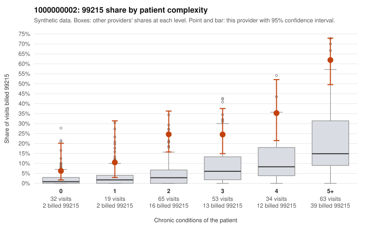

# 1000000002: Provider 1000000002 bills 99215 far above expectation in every complexity band, but the limited records returned largely support the billed levels, so the pattern is unresolved.

**Leaning (advisory):** Inconclusive

## Why

1000000002 billed 99215 on 31.6% of 266 claims against an expected 7.5% given patient complexity (risk-adjusted score 6.82; plain z-score vs peers 4.52). 5% of this provider's 99215 claims were on patients with 0 or 1 chronic conditions. Records came back for 30 claims. Of 13 documented 99215 claims, 2 (15%) were documented below the billed level, against 17% for the comparison providers. 3 of 29 notes claiming moderate-or-higher data reviewed had no lab or test line on the claim. The excess 99215 billing is not explained by panel complexity alone: the 99215 share runs roughly two to three times the all-provider share within every condition-count band, including patients with 5+ conditions. That persistence is the main signal pointing toward upcoding. Against that, the 13 documented 99215 claims show an unsupported rate in line with comparison providers, and supported examples such as C0000191 and C0000269 record high MDM with substantial minutes, which is consistent with a genuinely complex panel. The documentation is thin, though: about one in nine claims has records, and the few data-reviewed notes without a lab or test line on the claim are only a weak hint of templated or inflated notes. A reviewer should first request charts for the sampled low-complexity 99215 claims (C0000189 and C0000247 have no chronic conditions and single back-pain or rash diagnoses), check the two below-billed claims C0000131 and C0000283, and expand the records sample to see whether supported MDM holds up, or looks cloned, across more 99215 visits. Examples: C0000131: billed 99215; documented MDM level moderate, minutes not recorded. C0000283: billed 99215; documented MDM level moderate, minutes not recorded. C0000110: billed 99215, patient aged 36 with 1 chronic condition(s) (type 2 diabetes). C0000178: billed 99215, patient aged 54 with 1 chronic condition(s) (osteoarthritis).

## Evidence chart

## Cited claims

`C0000131`, `C0000283`, `C0000110`, `C0000178`

## Suggested next steps

- Request records for a larger sample of this provider's 99214 and 99215 claims; what came back is too thin to judge.
- Re-screen the provider once the records arrive.

---
Citations checked: 4/4 valid. Synthetic data. The leaning is advisory; the flag comes from the statistical screen, and no clinical documentation is available beyond the sampled records-review facts shown in the packet.
