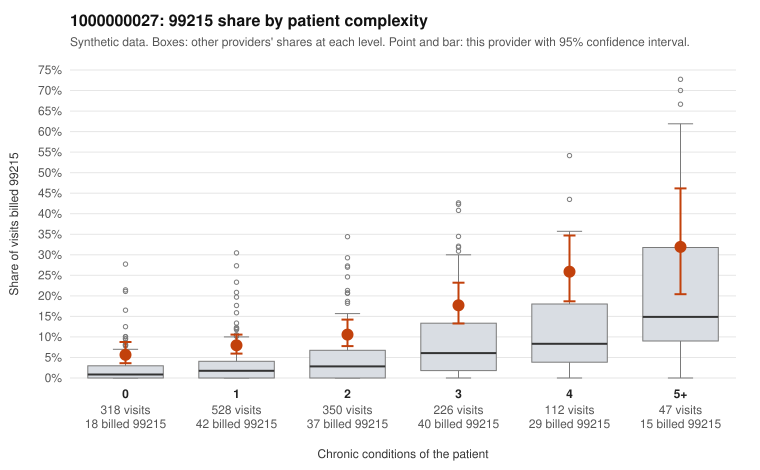

# 1000000027: Provider 1000000027 bills 99215 at roughly twice the all-provider rate in every complexity band, including on patients with no chronic conditions, but too few charts came back to confirm or refute upcoding.

**Leaning (advisory):** Inconclusive

## Why

1000000027 billed 99215 on 11.4% of 1,581 claims against an expected 3.6% given patient complexity (risk-adjusted score 7.57; plain z-score vs peers 1.06). 33% of this provider's 99215 claims were on patients with 0 or 1 chronic conditions. Records came back for 30 claims. Of 4 documented 99215 claims, 0 (0%) were documented below the billed level, against 17% for the comparison providers. 3 of 19 notes claiming moderate-or-higher data reviewed had no lab or test line on the claim. The elevation is not explained by a sicker panel. The 99215 share runs about double the all-provider share in every condition band, and the sampled low-complexity 99215s include visits with no chronic conditions coded only for upper respiratory infection, UTI, rash or follow-up (e.g., C0013170, C0013418, C0013154, C0014034), which is a pattern consistent with upcoding; the heavy concentration of 99214 in the mix points the same way. Against that, all four documented 99215s were supported, including three on single-condition patients (C0013071, C0013117, C0013296) documented at high MDM. But four charts out of 181 99215 claims is too thin to judge, and high MDM on a single-condition diabetes or depression visit is itself worth checking for templated or inflated notes, as are the 3 notes that claim moderate-plus data reviewed with no lab or test line on the claim. A reviewer should first request records targeted at the low-complexity 99215 claims listed in the packet and compare note content across visits for cloned language, then extend the request to a sample of 99214s. Examples: C0013760: billed 99213; documented MDM level straightforward, minutes not recorded. C0013005: billed 99215, patient aged 32 with 1 chronic condition(s) (type 2 diabetes). C0013014: billed 99215, patient aged 34 with 0 chronic condition(s).

## Evidence chart

## Cited claims

`C0013760`, `C0013005`, `C0013014`

## Suggested next steps

- Request records for a larger sample of this provider's 99214 and 99215 claims; what came back is too thin to judge.
- Re-screen the provider once the records arrive.

---
Citations checked: 3/3 valid. Synthetic data. The leaning is advisory; the flag comes from the statistical screen, and no clinical documentation is available beyond the sampled records-review facts shown in the packet.
