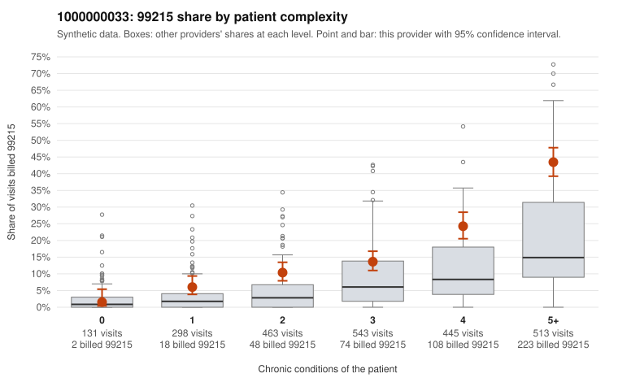

# 1000000033: Provider 1000000033 bills 99215 well above risk-adjusted expectation, with 99215s concentrated in multi-morbid patients, but the records sample is too thin to confirm or refute upcoding.

**Leaning (advisory):** Inconclusive

## Why

1000000033 billed 99215 on 19.8% of 2,393 claims against an expected 7.6% given patient complexity (risk-adjusted score 10.17; plain z-score vs peers 2.49). 4% of this provider's 99215 claims were on patients with 0 or 1 chronic conditions. Records came back for 30 claims. Of 5 documented 99215 claims, 0 (0%) were documented below the billed level, against 17% for the comparison providers. 2 of 21 notes claiming moderate-or-higher data reviewed had no lab or test line on the claim. The 99215 excess is real after risk adjustment, but it is concentrated where it would be expected: the share rises steadily with condition count, and very few 99215s land on patients with 0 or 1 conditions. That gradient looks more like a sicker panel than indiscriminate upcoding. The provider still runs above the all-provider share at every complexity level from one condition up, so heavier coding across the board is not ruled out. The documentation shows no unsupported claims, and the sampled 99215s (e.g., C0019945, C0019964) are documented at high MDM. However, only 5 documented 99215s exist, and two supported examples (C0019498, C0020728) have no recorded minutes, so this is too thin to judge. The small number of moderate-plus data-reviewed notes without a lab or test line is weak at most. A reviewer should first request a larger chart sample focused on 99215s, prioritizing low-complexity examples such as C0019106 and C0019626 (no chronic conditions). The broader 99214-heavy mix also warrants a look, including low-condition 99214s like C0019111 and C0020821. Examples: C0018637: billed 99215, patient aged 44 with 1 chronic condition(s) (hypertension). C0018644: billed 99215, patient aged 57 with 1 chronic condition(s) (obesity).

## Evidence chart

## Cited claims

`C0018637`, `C0018644`

## Suggested next steps

- Request records for a larger sample of this provider's 99214 and 99215 claims; what came back is too thin to judge.
- Re-screen the provider once the records arrive.

---
Citations checked: 2/2 valid. Synthetic data. The leaning is advisory; the flag comes from the statistical screen, and no clinical documentation is available beyond the sampled records-review facts shown in the packet.
