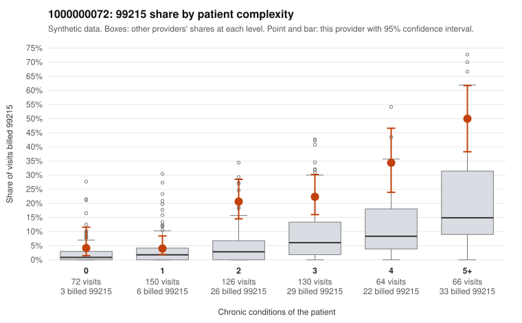

# 1000000072: Provider 1000000072's elevated 99215 rate sits mostly in patients with multiple chronic conditions, and the limited records reviewed largely support the billed level, which points toward a sicker panel rather than upcoding.

**Leaning (advisory):** Pattern consistent with a high-acuity panel

## Why

1000000072 billed 99215 on 19.6% of 608 claims against an expected 5.4% given patient complexity (risk-adjusted score 7.06; plain z-score vs peers 2.46). 8% of this provider's 99215 claims were on patients with 0 or 1 chronic conditions. Records came back for 30 claims. Of 9 documented 99215 claims, 1 (11%) were documented below the billed level, against 17% for the comparison providers. 1 of 24 notes claiming moderate-or-higher data reviewed had no lab or test line on the claim. The excess 99215 billing is concentrated in patients with 2 or more chronic conditions, while the 99215 share for 0-1 condition patients is close to the all-provider share, which is the opposite of the classic upcoding signature. The records review also leans toward legitimate billing. The documented-below-billed rate on 99215 claims is lower than the comparison providers'. Sampled supported claims (C0043084, C0043171, C0043541, and even low-complexity C0043372) show high MDM with substantial minutes. Only one note claiming moderate-or-higher data reviewed lacked a lab or test line, so there is little sign of cloned documentation. The main ambiguity is that the 99215 share within each multi-condition band still runs well above peers, and the risk-adjusted score remains high, so condition counts may not capture all the acuity. That judgement also rests on only 9 documented 99215 charts, which is too few to rule out a modest upcoding component. A reviewer should first pull more 99215 charts from the 2-4 condition bands to confirm the documented MDM there, then review the one unsupported claim, C0043026 (moderate MDM, minutes not recorded), and the sampled low-complexity 99215s such as C0042976 and C0043405 (Z09 follow-ups). Examples: C0043084: billed 99215; documented MDM level high, 46 minutes. C0043171: billed 99215; documented MDM level high, 35 minutes. C0043372: billed 99215, patient aged 57 with 1 chronic condition(s) (obesity); documented MDM level high, 49 minutes. C0042953: billed 99215, patient aged 64 with 4 chronic condition(s) (hyperlipidemia;depression;COPD;osteoarthritis). C0043141: billed 99215, patient aged 72 with 4 chronic condition(s) (hyperlipidemia;hypertension;atrial fibrillation;COPD).

## Evidence chart

## Cited claims

`C0043084`, `C0043171`, `C0043372`, `C0042953`, `C0043141`

## Suggested next steps

- Do not pursue recovery on this evidence: the documentation returned supports the level billed.
- Revisit if the provider's 99215 share keeps rising against peers, or if a larger records sample shows unsupported claims.

---
Citations checked: 5/5 valid. Synthetic data. The leaning is advisory; the flag comes from the statistical screen, and no clinical documentation is available beyond the sampled records-review facts shown in the packet.
