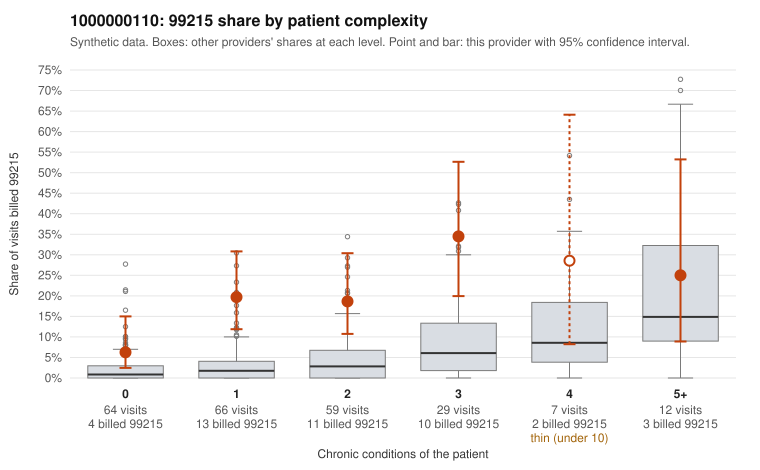

# 1000000110: Provider 1000000110 bills 99215 well above expectation, including on patients with few or no chronic conditions, but the small set of returned charts supports the billed level, so the case cannot be resolved on current evidence.

**Leaning (advisory):** Inconclusive

## Why

1000000110 billed 99215 on 18.1% of 237 claims against an expected 3.6% given patient complexity (risk-adjusted score 5.52; plain z-score vs peers 2.21). 40% of this provider's 99215 claims were on patients with 0 or 1 chronic conditions. Records came back for 30 claims. Of 6 documented 99215 claims, 0 (0%) were documented below the billed level, against 17% for the comparison providers. 8 of 17 notes claiming moderate-or-higher data reviewed had no lab or test line on the claim. The 99215 excess is not confined to sicker patients; it shows up in every complexity stratum and is sharpest among patients with 0 or 1 conditions, which fits upcoding better than a high-acuity panel. Sampled examples such as C0056566 and C0056672 (low back pain only) and C0056690 (follow-up Z09 only) are hard to square with high-complexity visits. Against that, none of the 6 documented 99215 claims fell below the billed level, but 6 charts is too few to judge. Some 'supported' notes look odd: C0056698 (a rash, no chronic conditions) and C0056542 (hyperlipidemia only) are documented at high MDM, and the notes claiming moderate-or-higher data review that have no lab or test line on the claim are weak signs of templated or inflated documentation, not proof. A reviewer should first request more charts, prioritising 99215 claims on 0–1 condition patients, and check those notes for cloned text and for data-review claims that no ordered tests back up. Examples: C0056517: billed 99214; documented MDM level low, minutes not recorded. C0056486: billed 99215, patient aged 38 with 1 chronic condition(s) (hyperlipidemia). C0056519: billed 99215, patient aged 46 with 1 chronic condition(s) (COPD).

## Evidence chart

## Cited claims

`C0056517`, `C0056486`, `C0056519`

## Suggested next steps

- Request records for a larger sample of this provider's 99214 and 99215 claims; what came back is too thin to judge.
- Re-screen the provider once the records arrive.

---
Citations checked: 3/3 valid. Synthetic data. The leaning is advisory; the flag comes from the statistical screen, and no clinical documentation is available beyond the sampled records-review facts shown in the packet.
