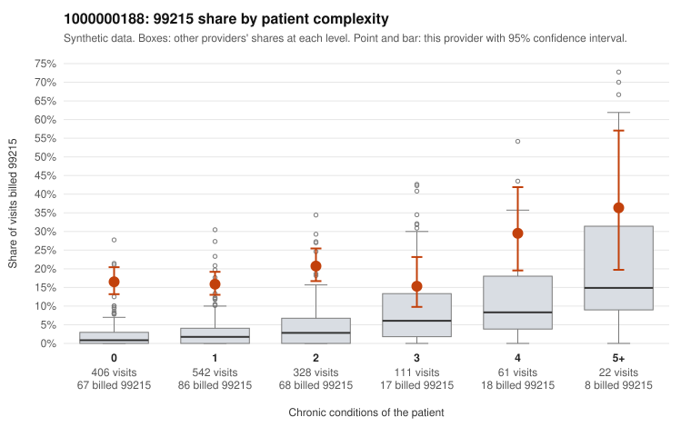

# 1000000188: Provider 1000000188 bills 99215 far above expectation, mostly on low-complexity patients, while the small documented sample supports every billed level, so the evidence conflicts and is too thin to settle.

**Leaning (advisory):** Inconclusive

## Why

1000000188 billed 99215 on 18.0% of 1,470 claims against an expected 2.9% given patient complexity (risk-adjusted score 15.66; plain z-score vs peers 2.18). 58% of this provider's 99215 claims were on patients with 0 or 1 chronic conditions. Records came back for 30 claims. Of 8 documented 99215 claims, 0 (0%) were documented below the billed level, against 17% for the comparison providers. 6 of 23 notes claiming moderate-or-higher data reviewed had no lab or test line on the claim. The billing pattern is consistent with upcoding. The 99215 excess holds in every complexity stratum, and the 0–1 condition strata carry the largest absolute excess. The sampled low-complexity 99215 claims are mostly single minor problems such as back pain, rash, abdominal pain, URI or follow-up codes (e.g., C0091319, C0091920, C0092080, C0092024). By contrast, the high-complexity samples (e.g., C0091355, C0091420) look appropriately coded. The documentation points the other way, since none of the 8 documented 99215 claims fell below the billed level (examples C0092308, C0092367). But 8 charts from a 2% records return cannot carry much weight. The 6 notes claiming moderate-or-higher data review with no lab or test line on the claim are weak evidence that notes may be templated or inflated to match billing. A reviewer should first request charts targeted at the low-complexity 99215 claims listed in the packet. Those charts should be checked for cloned MDM language and for whether the data and time elements, including the unrecorded minutes on C0091770 and C0091858, match what actually happened at the visit. Examples: C0090951: billed 99215, patient aged 24 with 1 chronic condition(s) (obesity). C0090956: billed 99215, patient aged 26 with 1 chronic condition(s) (type 2 diabetes).

## Evidence chart

## Cited claims

`C0090951`, `C0090956`

## Suggested next steps

- Request records for a larger sample of this provider's 99214 and 99215 claims; what came back is too thin to judge.
- Re-screen the provider once the records arrive.

---
Citations checked: 2/2 valid. Synthetic data. The leaning is advisory; the flag comes from the statistical screen, and no clinical documentation is available beyond the sampled records-review facts shown in the packet.
