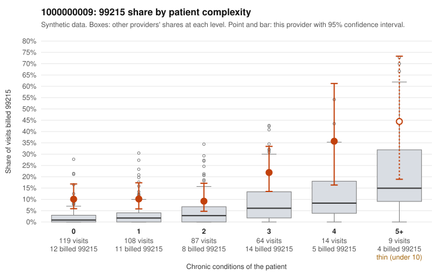

# 1000000009: Provider 1000000009 bills 99215 well above expectation in every complexity band, including many low-complexity visits, but the sampled charts largely support the billed levels, so the picture is unresolved.

**Leaning (advisory):** Inconclusive

## Why

1000000009 billed 99215 on 13.5% of 401 claims against an expected 3.3% given patient complexity (risk-adjusted score 5.22; plain z-score vs peers 1.41). 43% of this provider's 99215 claims were on patients with 0 or 1 chronic conditions. Records came back for 45 claims. Of 19 documented 99215 claims, 1 (5%) were documented below the billed level, against 17% for the comparison providers. Note checks on 45 returned notes (share showing each sign): problems 33%, late 2%, unsigned 0%, data 7%. No audit trail was received. 4 of 30 notes claiming moderate-or-higher data reviewed had no lab or test line on the claim. The elevated 99215 share is not concentrated in sicker patients. It appears in the 0- and 1-condition bands too, and sampled 99215s include simple presentations such as upper respiratory infection (C0003110, C0003224), follow-up visits (C0003291, C0003292) and abdominal pain (C0003312), which is the pattern of concern. Against that, the documented 99215 claims rarely fall below the billed level, well under the comparison rate, and on the face of the charts this argues for a legitimately complex panel. Even so, high-MDM notes on simple visits such as C0003224 (J06.9) and C0003090 (N39.0) are clinically surprising. Together with the frequent problem-list note signal, the handful of moderate-plus data claims with no lab or test line, and the missing audit trail, this leaves open the possibility that notes are templated or inflated to match the billed code, though it does not establish it. A reviewer should first pull the full notes for the supported low-complexity 99215s (C0003090, C0003193, C0003224, C0003455) and the problem-signal examples, and judge whether the documented MDM is clinically credible for the stated diagnosis. The reviewer should also request the EHR audit trail to check for cloning or bulk note creation before drawing a conclusion. Examples: C0003346: billed 99215; documented MDM level moderate, 33 minutes. C0003090: billed 99215, patient aged 60 with 0 chronic condition(s); documented MDM level high, 33 minutes. C0003110: billed 99215, patient aged 55 with 0 chronic condition(s).

## Evidence chart

## Cited claims

`C0003346`, `C0003090`, `C0003110`

## Suggested next steps

- 45 charts came back but do not settle it: request a targeted sample of 99215 charts, starting with C0003346, C0003090, C0003110.
- Re-check after the targeted charts arrive; do not call upcoding or a sicker panel on this evidence alone.

---
Citations checked: 3/3 valid. Synthetic data. The leaning is advisory; the flag comes from the statistical screen, and no clinical documentation is available beyond the sampled records-review facts shown in the packet.
