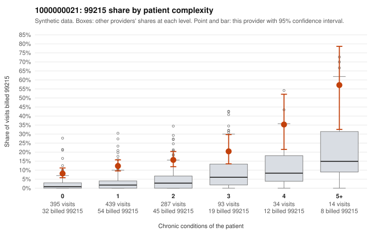

# 1000000021: Provider 1000000021 bills 99215 well above the risk-adjusted expectation in every complexity group, including many low-complexity visits, yet the small documented sample largely supports the billed levels.

**Leaning (advisory):** Inconclusive

## Why

1000000021 billed 99215 on 13.5% of 1,262 claims against an expected 2.7% given patient complexity (risk-adjusted score 10.71; plain z-score vs peers 1.41). 51% of this provider's 99215 claims were on patients with 0 or 1 chronic conditions. Records came back for 45 claims. Of 19 documented 99215 claims, 1 (5%) were documented below the billed level, against 17% for the comparison providers. Note checks on 45 returned notes (share showing each sign): problems 49%, late 7%, unsigned 0%, data 0%, bulk created 0%, paste heavy 0%. 2 of 36 notes claiming moderate-or-higher data reviewed had no lab or test line on the claim. The claims pattern points toward upcoding. The 99215 share runs roughly three times the all-provider rate in every condition-count group, and about half of these visits are on patients with 0 or 1 chronic conditions, often for simple diagnoses such as UTI, abdominal pain or follow-up (e.g., C0009065, C0009087, C0009308). The records review points the other way: the documented 99215 unsupported rate is well below the comparison rate, supported examples show high MDM with 45-52 minutes (e.g., C0009264, C0009981), and cloning signals are nearly absent (no paste-heavy, duplicate or bulk-created notes, and only 2 moderate-plus data claims lacking a lab line). The ambiguity is that records cover only a small share of claims and 19 documented 99215s, so a reviewer should first confirm how many of those came from the low-complexity group (the one unsupported claim, C0009169, did). The reviewer should also examine the notes behind the high 'problems' flag rate (e.g., C0008921, C0008927, C0008980) and the repeated-time entries for possible inflated problem lists or templated time. Requesting additional charts specifically for low-complexity 99215 claims would most directly resolve whether this is a complex practice or documentation that matches the billing rather than the visit. Examples: C0009169: billed 99215, patient aged 39 with 0 chronic condition(s); documented MDM level moderate, minutes not recorded. C0009049: billed 99215, patient aged 47 with 1 chronic condition(s) (osteoarthritis). C0009065: billed 99215, patient aged 21 with 0 chronic condition(s).

## Evidence chart

## Cited claims

`C0009169`, `C0009049`, `C0009065`

## Suggested next steps

- 45 charts came back but do not settle it: request a targeted sample of 99215 charts, starting with C0009169, C0009049, C0009065.
- Re-check after the targeted charts arrive; do not call upcoding or a sicker panel on this evidence alone.

---
Citations checked: 3/3 valid. Synthetic data. The leaning is advisory; the flag comes from the statistical screen, and no clinical documentation is available beyond the sampled records-review facts shown in the packet.
