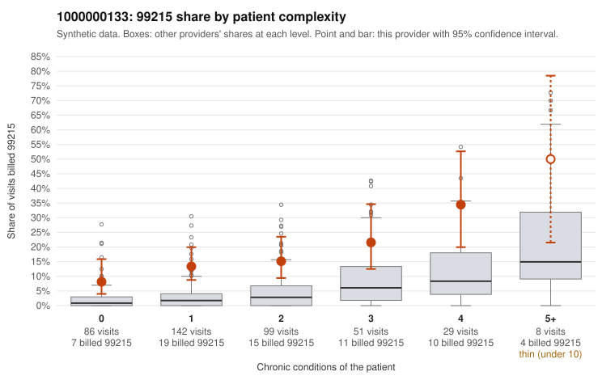

# 1000000133: Provider 1000000133 bills 99215 far above expectation at every complexity level, including many visits for minor complaints, but every returned 99215 chart documents the billed level, so the record conflicts with itself.

**Leaning (advisory):** Inconclusive

## Why

1000000133 billed 99215 on 15.9% of 415 claims against an expected 3.4% given patient complexity (risk-adjusted score 6.40; plain z-score vs peers 1.83). 39% of this provider's 99215 claims were on patients with 0 or 1 chronic conditions. Records came back for 45 claims. Of 19 documented 99215 claims, 0 (0%) were documented below the billed level, against 17% for the comparison providers. Note checks on 45 returned notes (share showing each sign): problems 22%, late 0%, unsigned 0%, data 4%. No audit trail was received. 4 of 33 notes claiming moderate-or-higher data reviewed had no lab or test line on the claim. The billing pattern on its own points toward upcoding. The 99215 share runs roughly two to four times the all-provider share in every complexity stratum, not just among sicker patients, and many sampled low-complexity 99215s carry only acute minor diagnoses such as rash (R21) or upper respiratory infection (J06.9) (e.g., C0067360, C0067365, C0067760). The documentation points the other way: none of the 19 documented 99215s fell below the billed level, against the 17% comparison rate. That is what a legitimately complex panel would look like, unless the notes themselves are inflated. Some signs suggest they might be. C0067410 is a rash visit with no chronic conditions, yet it is documented as high MDM with no time recorded, and it is flagged on the problems note signal along with C0067442, a hypertension-only 99215. About 14% of notes repeat times, a small number claim moderate-plus data with no lab line, and no audit trail was received to rule out cloned or templated notes. A reviewer should first read the full notes for the low-complexity 99215s, starting with C0067410 and C0067442, to test whether the documented problems and data match a single minor complaint. The next steps are to request the EHR audit trail and pull a larger, targeted chart sample of low-complexity 99215s. Examples: C0067427: billed 99214; documented MDM level low, 21 minutes. C0067360: billed 99215, patient aged 69 with 0 chronic condition(s). C0067365: billed 99215, patient aged 46 with 0 chronic condition(s).

## Evidence chart

## Cited claims

`C0067427`, `C0067360`, `C0067365`

## Suggested next steps

- 45 charts came back but do not settle it: request a targeted sample of 99215 charts, starting with C0067427, C0067360, C0067365.
- Re-check after the targeted charts arrive; do not call upcoding or a sicker panel on this evidence alone.

---
Citations checked: 3/3 valid. Synthetic data. The leaning is advisory; the flag comes from the statistical screen, and no clinical documentation is available beyond the sampled records-review facts shown in the packet.
