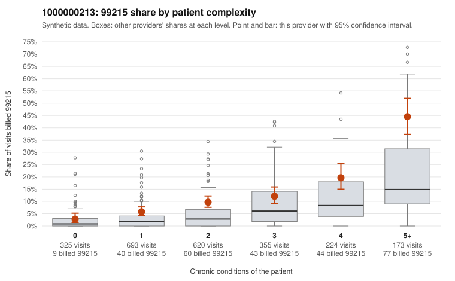

# 1000000213: 1000000213: documented 99215 claims mostly support the level billed (0% below)

**Leaning (advisory):** Pattern consistent with a high-acuity panel

## Why

1000000213 billed 99215 on 11.4% of 2,390 claims against an expected 4.5% given patient complexity (risk-adjusted score 7.37; plain z-score vs peers 1.06). 18% of this provider's 99215 claims were on patients with 0 or 1 chronic conditions. Records came back for 45 claims. Of 17 documented 99215 claims, 0 (0%) were documented below the billed level, against 17% for the comparison providers. Note checks on 45 returned notes (share showing each sign): problems 20%, late 4%, unsigned 0%, data 0%. No audit trail was received. 2 of 36 notes claiming moderate-or-higher data reviewed had no lab or test line on the claim. This pattern is consistent with a high-acuity panel. The sampled documentation supports the billed level. Examples: C0104727: billed 99215; documented MDM level high, minutes not recorded. C0104873: billed 99215; documented MDM level high, 42 minutes. C0105050: billed 99215; documented MDM level high, 49 minutes. C0105175: billed 99215, patient aged 64 with 5 chronic condition(s) (obesity;hypertension;asthma;osteoarthritis;chronic kidney disease). C0105219: billed 99215, patient aged 83 with 4 chronic condition(s) (type 2 diabetes;obesity;hyperlipidemia;hypertension).

## Evidence chart

## Cited claims

`C0104727`, `C0104873`, `C0105050`, `C0105175`, `C0105219`

## Suggested next steps

- Do not pursue recovery on this evidence: 45 charts came back and they support the level billed (0 of 17 documented 99215 claims below the billed level).
- Revisit if the 99215 share keeps rising against peers or a larger sample shows unsupported claims.

---
Citations checked: 5/5 valid. Synthetic data. The leaning is advisory; the flag comes from the statistical screen, and no clinical documentation is available beyond the sampled records-review facts shown in the packet.
