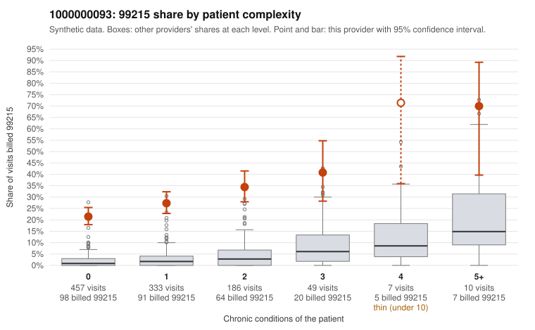

# Payment Integrity dossier: 1000000093

> Draft for human review. Statistical and records-sample evidence only; not a finding. Compliance or legal review is needed before any provider contact, notice or recoupment.

## Provider overview

| | |
|---|---|
| Specialty / state | Family Practice, GA (synthetic) |
| Claims / patients | 1,042 / 510 |
| Billed mix (99211 to 99215) | 4 / 3 / 172 / 578 / 285 |
| 99215 share | 27.4% |
| Expected 99215 share given patient complexity | 2.2% |
| Screen scores | z vs peers 3.79; risk-adjusted 24.53; flagged by suspicion>=5 |

## Case summary (advisory)

**1000000093: 15 of 23 documented 99215 claims (65%) are documented below the billed level**

Leaning: pattern consistent with upcoding. Citations checked: 6/6 valid.

1000000093 billed 99215 on 27.4% of 1,042 claims against an expected 2.2% given patient complexity (risk-adjusted score 24.53; plain z-score vs peers 3.79). 66% of this provider's 99215 claims were on patients with 0 or 1 chronic conditions. Records came back for 44 claims. Of 23 documented 99215 claims, 15 (65%) were documented below the billed level, against 17% for the comparison providers. Note checks on 44 returned notes (share showing each sign): problems 39%, late 7%, unsigned 0%, data 0%, bulk created 0%, paste heavy 2%. 1 of 33 notes claiming moderate-or-higher data reviewed had no lab or test line on the claim. This pattern is consistent with upcoding. It is a reason to review the records, not a finding. Examples: C0051978: billed 99215; documented MDM level moderate, 30 minutes. C0052021: billed 99215; documented MDM level moderate, 33 minutes. C0052476: billed 99215; documented MDM level moderate, minutes not recorded. C0051982: billed 99215, patient aged 25 with 1 chronic condition(s) (heart failure). C0051988: billed 99215, patient aged 40 with 0 chronic condition(s). C0052048: billed 99215, patient aged 65 with 0 chronic condition(s).

## Evidence chart

## Records-review sample so far

Documentation is on file for 44 claims (4% of this provider's claims).

| Billed | Documented | Documentation below billed level | Rate | All-provider rate |
|---|---|---|---|---|
| 99213 | 4 | 0 | 0.0% | 6.2% |
| 99214 | 17 | 2 | 11.8% | 2.6% |
| 99215 | 23 | 15 | 65.2% | 17.4% |

## Recommended next steps for Payment Integrity

1. Request records for the sampled claims in `record_request_list.csv` (55 claims across 99215).
2. Review the records against E/M documentation rules and record the supported level for each claim.
3. Run the overpayment estimator on the reviewed sample (`sampling_plan.md` explains how).
4. Notice, appeal rights, recoupment, education or corrective action, and any referral are decisions for the PI team, compliance and counsel. Nothing here drafts those.

Suggested follow-ups from the case summary:

- Request the full charts for C0051978, C0052021, C0052476 and have a certified coder re-score each against the current E/M rules (medical decision making or total time).
- If the re-scoring confirms the pattern, review the random sample in the recovery packet's sampling plan before any overpayment estimate; do not extrapolate from a targeted sample.
- Look at the notes themselves: 39% address fewer problems than their level implies and 7% were signed late; request the audit trail for C0051978, C0052021, C0052476.

## Limits

- Synthetic data; no real claims or providers.
- The leaning is advisory. The flag comes from the statistical screen; the summary explains it.
- The records-review sample is partial and was simulated for this project.
- Allowed amounts are GA Family Practice averages from a public CMS file, not this provider's actual payments.
