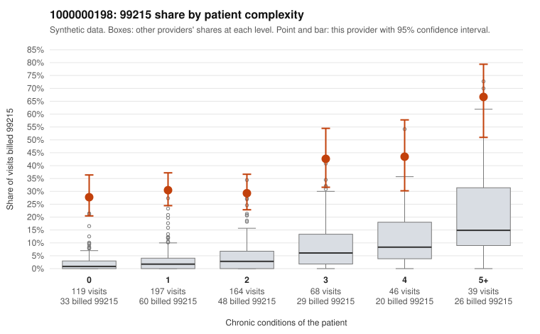

# Payment Integrity dossier: 1000000198

> Draft for human review. Statistical and records-sample evidence only; not a finding. Compliance or legal review is needed before any provider contact, notice or recoupment.

## Provider overview

| | |
|---|---|
| Specialty / state | Family Practice, GA (synthetic) |
| Claims / patients | 633 / 307 |
| Billed mix (99211 to 99215) | 0 / 0 / 58 / 359 / 216 |
| 99215 share | 34.1% |
| Expected 99215 share given patient complexity | 4.0% |
| Screen scores | z vs peers 4.95; risk-adjusted 17.51; flagged by suspicion>=5 |

## Case summary (advisory)

**1000000198: 0 of 11 documented 99215 claims (0%) are documented below the billed level**

Leaning: pattern consistent with upcoding. Citations checked: 5/5 valid.

1000000198 billed 99215 on 34.1% of 633 claims against an expected 4.0% given patient complexity (risk-adjusted score 17.51; plain z-score vs peers 4.95). 43% of this provider's 99215 claims were on patients with 0 or 1 chronic conditions. Records came back for 30 claims. Of 11 documented 99215 claims, 0 (0%) were documented below the billed level, against 17% for the comparison providers. Note checks on 30 returned notes (share showing each sign): problems 37%, late 13%, unsigned 0%, data 13%, bulk created 10%, paste heavy 17%. 6 of 24 notes claiming moderate-or-higher data reviewed had no lab or test line on the claim. This pattern is consistent with upcoding. It is a reason to review the records, not a finding. Examples: C0095731: billed 99213; documented MDM level straightforward, minutes not recorded. C0095830: billed 99214; documented MDM level low, minutes not recorded. C0095220: billed 99215, patient aged 23 with 1 chronic condition(s) (hyperlipidemia). C0095270: billed 99215, patient aged 42 with 0 chronic condition(s). C0095312: billed 99215, patient aged 45 with 1 chronic condition(s) (hypothyroidism).

## Evidence chart

## Records-review sample so far

Documentation is on file for 30 claims (5% of this provider's claims).

| Billed | Documented | Documentation below billed level | Rate | All-provider rate |
|---|---|---|---|---|
| 99213 | 2 | 1 | 50.0% | 6.2% |
| 99214 | 17 | 1 | 5.9% | 2.6% |
| 99215 | 11 | 0 | 0.0% | 17.4% |

## Recommended next steps for Payment Integrity

1. Request records for the sampled claims in `record_request_list.csv` (52 claims across 99215).
2. Review the records against E/M documentation rules and record the supported level for each claim.
3. Run the overpayment estimator on the reviewed sample (`sampling_plan.md` explains how).
4. Notice, appeal rights, recoupment, education or corrective action, and any referral are decisions for the PI team, compliance and counsel. Nothing here drafts those.

Suggested follow-ups from the case summary:

- Request the full charts for C0095731, C0095830, C0095220 and have a certified coder re-score each against the current E/M rules (medical decision making or total time).
- If the re-scoring confirms the pattern, review the random sample in the recovery packet's sampling plan before any overpayment estimate; do not extrapolate from a targeted sample.
- Look at the notes themselves: 37% address fewer problems than their level implies and 13% were signed late; request the audit trail for C0095731, C0095830, C0095220.

## Limits

- Synthetic data; no real claims or providers.
- The leaning is advisory. The flag comes from the statistical screen; the summary explains it.
- The records-review sample is partial and was simulated for this project.
- Allowed amounts are GA Family Practice averages from a public CMS file, not this provider's actual payments.
