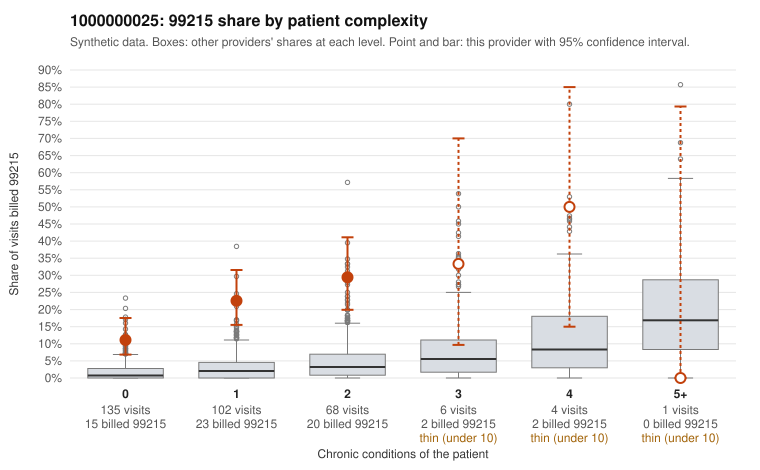

# 1000000025: Provider 1000000025 bills 99215 at elevated rates within every complexity tier, including patients with no chronic conditions, but too few charts came back to confirm or rule out upcoding.

**Leaning (advisory):** Pattern consistent with upcoding

## Why

1000000025 billed 99215 on 19.6% of 316 claims against an expected 2.0% given patient complexity (risk-adjusted score 7.59; plain z-score vs peers 2.76). 61% of this provider's 99215 claims were on patients with 0 or 1 chronic conditions. Records came back for 30 claims. Of 4 documented 99215 claims, 1 (25%) were documented below the billed level, against 0% for the comparison providers. 2 of 24 notes claiming moderate-or-higher data reviewed had no lab or test line on the claim. The excess is not explained by a sicker panel: most visits are for patients with 0–2 conditions, and the 99215 share is several times the all-provider share within each of those tiers. The sampled 99215s are mostly single-complaint or follow-up visits on low-complexity patients (e.g., C0014345 and C0014417 coded only Z09, C0014463 coded J06.9), and 99214 dominates the rest of the mix. The documentation is too thin to judge: only 4 documented 99215 claims, and the rule check found the result not lopsided. One of those, C0014628, was documented at moderate. Two others, C0014495 (low back pain, 0 conditions) and C0014597 (rash, 0 conditions), were documented as high MDM, which is either a genuine finding or a sign of templated or inflated notes worth reading closely. A reviewer should first request additional charts weighted toward 99215s on 0–1 condition patients, and should compare note content across patients for cloned language, including the 2 notes claiming substantial data review with no lab or test line on the claim. Examples: C0014628: billed 99215, patient aged 77 with 0 chronic condition(s); documented MDM level moderate, minutes not recorded. C0014316: billed 99215, patient aged 52 with 1 chronic condition(s) (osteoarthritis). C0014345: billed 99215, patient aged 47 with 0 chronic condition(s). C0014355: billed 99215, patient aged 41 with 0 chronic condition(s).

## Evidence chart

## Cited claims

`C0014628`, `C0014316`, `C0014345`, `C0014355`

## Suggested next steps

- Request the full records for the cited claims and have a certified coder re-score each against current E/M documentation rules (medical decision making or total time).
- If the re-scoring confirms the pattern, use the sampling plan in the recovery packet to review a statistical sample of this provider's 99215 claims.
- Check whether notes for the cited claims look copied forward, and whether documented minutes repeat from visit to visit.

---
Citations checked: 4/4 valid. Synthetic data. The leaning is advisory; the flag comes from the statistical screen, and no clinical documentation is available beyond the sampled records-review facts shown in the packet.
