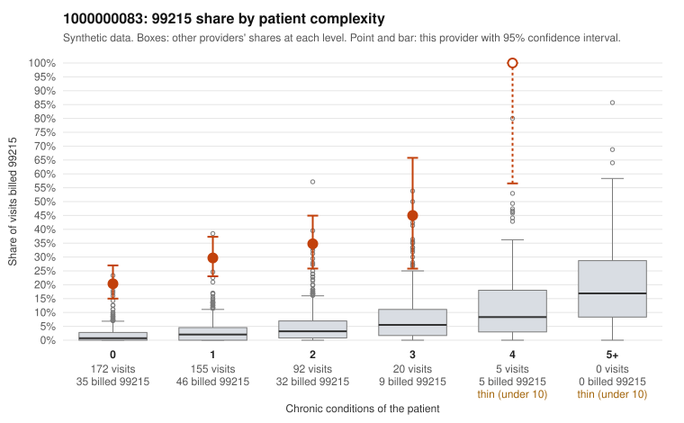

# 1000000083: Provider 1000000083 bills 99215 far above expectation, largely on low-complexity patients, but the small set of returned charts supports the billed levels, so the evidence conflicts.

**Leaning (advisory):** Inconclusive

## Why

1000000083 billed 99215 on 28.6% of 444 claims against an expected 2.1% given patient complexity (risk-adjusted score 13.44; plain z-score vs peers 4.45). 64% of this provider's 99215 claims were on patients with 0 or 1 chronic conditions. Records came back for 30 claims. Of 9 documented 99215 claims, 0 (0%) were documented below the billed level, against 0% for the comparison providers. 1 of 23 notes claiming moderate-or-higher data reviewed had no lab or test line on the claim. The claims pattern is the main concern. The elevated 99215 share appears in every complexity stratum, not just among complex patients. The sampled low-complexity 99215s include young patients with no chronic conditions billed for routine diagnoses such as upper respiratory infection, rash and low back pain (e.g., C0035241, C0035278, C0035237, C0035554), which is the profile where top-level visits are hardest to justify. Against that, none of the 9 documented 99215 claims fell below the billed level, and the supported examples show high-complexity medical decision-making (MDM) with substantial minutes. However, 9 charts out of 127 99215 claims is too thin to settle the question, and documentation that matches the billed level can still be templated or inflated. The single note claiming moderate-or-higher data reviewed with no lab or test line on the claim is only weak evidence of that. A reviewer should first request and review charts specifically for the low-complexity 99215 claims listed here, checking whether the MDM narrative fits a minor acute problem and whether notes look cloned across patients, before drawing any conclusion. Examples: C0035231: billed 99215, patient aged 41 with 1 chronic condition(s) (hypertension). C0035237: billed 99215, patient aged 29 with 0 chronic condition(s).

## Evidence chart

## Cited claims

`C0035231`, `C0035237`

## Suggested next steps

- Request records for a larger sample of this provider's 99214 and 99215 claims; what came back is too thin to judge.
- Re-screen the provider once the records arrive.

---
Citations checked: 2/2 valid. Synthetic data. The leaning is advisory; the flag comes from the statistical screen, and no clinical documentation is available beyond the sampled records-review facts shown in the packet.
