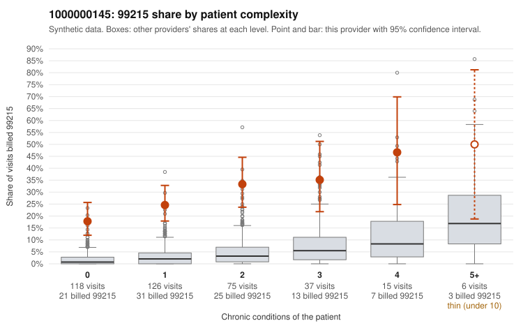

# 1000000145: Provider 1000000145 bills 99215 far above expectation across every complexity tier, including many visits for minor acute complaints, but records returned for too few claims to test whether documentation supports the levels.

**Leaning (advisory):** Inconclusive

## Why

1000000145 billed 99215 on 26.5% of 377 claims against an expected 2.6% given patient complexity (risk-adjusted score 9.87; plain z-score vs peers 4.06). 52% of this provider's 99215 claims were on patients with 0 or 1 chronic conditions. Records came back for 6 claims. Of 1 documented 99215 claims, 0 (0%) were documented below the billed level, against 0% for the comparison providers. 0 of 4 notes claiming moderate-or-higher data reviewed had no lab or test line on the claim. The billing pattern leans toward concern. The 99215 share exceeds the all-provider share in every complexity band, and is roughly ten times higher among patients with zero chronic conditions. The sampled low-complexity 99215 claims are mostly for routine problems such as upper respiratory infection (C0068194, C0068313), rash (C0068089, C0068422), back pain (C0068331) and follow-up visits (C0068296, C0068406), which would rarely need high-complexity decision making. Some high-complexity 99215 claims (for example C0068159 and C0068250) are plausible, and the rise in 99215 share with complexity shows the provider is not coding at random. Even so, sicker patients do not explain the excess at the low end. The documentation cannot settle this: only one 99215 note came back (C0068188, supported), and too few 99214 and 99215 records exist to lean either way. The no-lab check on data-reviewed notes raised no flags, but it is equally thin. A reviewer should first request charts for the sampled 0–1 condition 99215 claims, such as C0068075, C0068194, C0068216 and C0068296, and check whether the documented decision making and time genuinely support high complexity or read as templated. Examples: C0068075: billed 99215, patient aged 29 with 0 chronic condition(s). C0068088: billed 99215, patient aged 58 with 1 chronic condition(s) (heart failure).

## Evidence chart

## Cited claims

`C0068075`, `C0068088`

## Suggested next steps

- Request records for a larger sample of this provider's 99214 and 99215 claims; what came back is too thin to judge.
- Re-screen the provider once the records arrive.

---
Citations checked: 2/2 valid. Synthetic data. The leaning is advisory; the flag comes from the statistical screen, and no clinical documentation is available beyond the sampled records-review facts shown in the packet.
