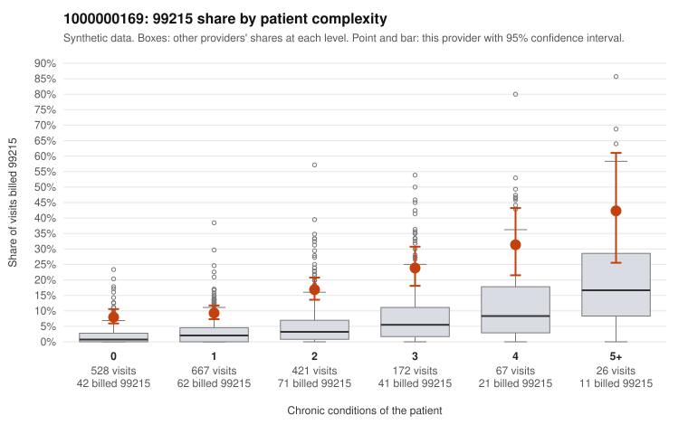

# 1000000169: Elevated 99215 use spread across all complexity tiers, including many low-complexity visits, but records came back for too few claims to confirm or rule out upcoding.

**Leaning (advisory):** Inconclusive

## Why

1000000169 billed 99215 on 13.2% of 1,881 claims against an expected 2.6% given patient complexity (risk-adjusted score 9.77; plain z-score vs peers 1.56). 42% of this provider's 99215 claims were on patients with 0 or 1 chronic conditions. Records came back for 30 claims. Of 1 documented 99215 claims, 0 (0%) were documented below the billed level, against 0% for the comparison providers. 0 of 14 notes claiming moderate-or-higher data reviewed had no lab or test line on the claim. The billing pattern raises concern: this provider's 99215 share runs several times the all-provider rate in every complexity tier, including patients with zero or one chronic condition, and 99214 dominates the overall mix. The sampled low-complexity 99215 claims carry simple diagnoses such as rash (R21), upper respiratory infection (J06.9), abdominal pain (R10.9) and follow-up (Z09), for example C0081131, C0082009 and C0082522. That is the pattern most consistent with upcoding rather than a sicker panel. Against that, the documentation is too thin to judge. Only one documented 99215 (C0082469, CKD, high MDM, 40 minutes) came back, and it supported the billed level. The documented 99213 and 99214 claims show no lopsided mismatch, and no notes claiming moderate-or-higher data reviewed lacked a lab or test line. A reviewer should first request charts for the sampled low-complexity 99215 claims, especially the zero-condition R21, J06.9 and R10.9 visits, to see whether high-complexity MDM or time is actually documented. Examples: C0082314: billed 99213; documented MDM level straightforward, minutes not recorded. C0081131: billed 99215, patient aged 67 with 0 chronic condition(s). C0081211: billed 99215, patient aged 55 with 0 chronic condition(s).

## Evidence chart

## Cited claims

`C0082314`, `C0081131`, `C0081211`

## Suggested next steps

- Request records for a larger sample of this provider's 99214 and 99215 claims; what came back is too thin to judge.
- Re-screen the provider once the records arrive.

---
Citations checked: 3/3 valid. Synthetic data. The leaning is advisory; the flag comes from the statistical screen, and no clinical documentation is available beyond the sampled records-review facts shown in the packet.
