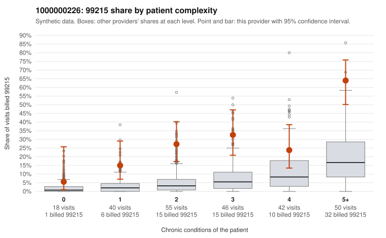

# 1000000226: Provider 1000000226 bills 99215 far above expectation in every complexity tier, but the few returned charts support the billed levels, so the documentation is too thin to settle whether this is upcoding or a sicker panel.

**Leaning (advisory):** Inconclusive

## Why

1000000226 billed 99215 on 31.5% of 251 claims against an expected 6.3% given patient complexity (risk-adjusted score 5.61; plain z-score vs peers 4.99). 9% of this provider's 99215 claims were on patients with 0 or 1 chronic conditions. Records came back for 24 claims. Of 4 documented 99215 claims, 0 (0%) were documented below the billed level, against 0% for the comparison providers. 3 of 16 notes claiming moderate-or-higher data reviewed had no lab or test line on the claim. The risk-adjusted excess is not explained by panel mix alone. This provider's 99215 share runs well above the all-provider share in every complexity stratum, including 0–1 condition patients, and the coding mix skews entirely to 99213 and above, with no 99211 or 99212 claims. That said, most 99215s fall on multi-morbid patients, and only a small share are on low-complexity patients. The records review offers no contradiction, since all 4 documented 99215s were supported at high MDM, but 4 charts is too few to judge. Two of those supported notes (C0114103, depression with an acute URI code, and C0114202, hyperlipidemia only) are on 1-condition patients where high MDM is surprising. Together with the 3 data-reviewed notes lacking any lab or test line, that is weak evidence that notes may be templated or inflated, not proof. A reviewer should first obtain more charts, prioritizing low-complexity 99215s such as C0114066, C0114118, C0114138 and the repeat visits by M0048051 (C0114103, C0114282), and check whether the high-MDM notes reflect visit-specific content or cloned text. Examples: C0114066: billed 99215, patient aged 64 with 0 chronic condition(s). C0114074: billed 99215, patient aged 75 with 1 chronic condition(s) (depression).

## Evidence chart

## Cited claims

`C0114066`, `C0114074`

## Suggested next steps

- Request records for a larger sample of this provider's 99214 and 99215 claims; what came back is too thin to judge.
- Re-screen the provider once the records arrive.

---
Citations checked: 2/2 valid. Synthetic data. The leaning is advisory; the flag comes from the statistical screen, and no clinical documentation is available beyond the sampled records-review facts shown in the packet.
