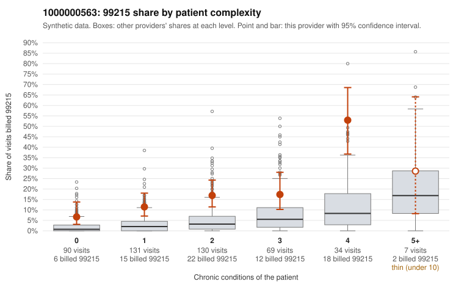

# 1000000563: Provider 1000000563 bills 99215 well above expectation in every complexity stratum, including low-complexity patients, but the few documented 99215 claims support the billed level, so the records are too thin to settle the question.

**Leaning (advisory):** Inconclusive

## Why

1000000563 billed 99215 on 16.3% of 461 claims against an expected 3.2% given patient complexity (risk-adjusted score 5.41; plain z-score vs peers 2.14). 28% of this provider's 99215 claims were on patients with 0 or 1 chronic conditions. Records came back for 30 claims. Of 6 documented 99215 claims, 0 (0%) were documented below the billed level, against 0% for the comparison providers. 4 of 20 notes claiming moderate-or-higher data reviewed had no lab or test line on the claim. The elevation is not confined to sicker patients. The provider's 99215 share exceeds the all-provider share in every condition-count band, including patients with no chronic conditions, and the sample includes 99215s on simple presentations such as rash-only visits (C0286812, C0286845) and URI-only visits (C0287081), a pattern consistent with upcoding rather than a complex panel. Against that, all 6 documented 99215 claims (for example C0286829 and C0286936) were documented at high MDM, but 6 charts is too few to judge. Most of those notes also lack recorded minutes, and 4 notes claiming moderate-or-higher data review have no lab or test line on the claim, which is weak evidence that some notes may be templated or inflated. A reviewer should first request charts for the low-complexity 99215 claims listed in the packet, checking whether the MDM rationale fits the diagnoses and whether the data-review elements match tests actually ordered. Examples: C0287099: billed 99213; documented MDM level straightforward, minutes not recorded. C0286797: billed 99215, patient aged 66 with 1 chronic condition(s) (obesity). C0286812: billed 99215, patient aged 54 with 0 chronic condition(s).

## Evidence chart

## Cited claims

`C0287099`, `C0286797`, `C0286812`

## Suggested next steps

- Request records for a larger sample of this provider's 99214 and 99215 claims; what came back is too thin to judge.
- Re-screen the provider once the records arrive.

---
Citations checked: 3/3 valid. Synthetic data. The leaning is advisory; the flag comes from the statistical screen, and no clinical documentation is available beyond the sampled records-review facts shown in the packet.
