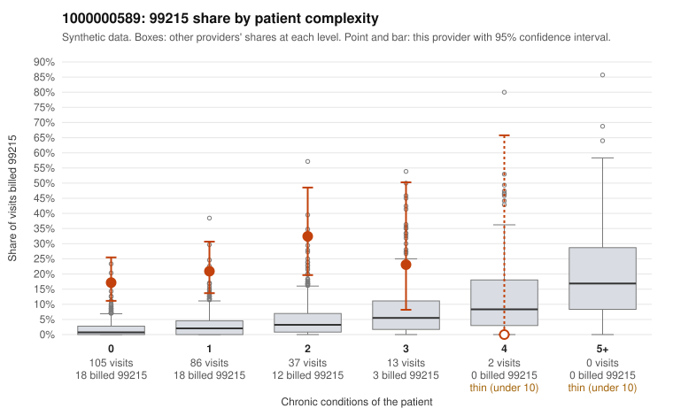

# 1000000589: Provider 1000000589 bills 99215 far above expectation, mostly on low-complexity patients, yet the few returned charts document high MDM, so the conflict is unresolved.

**Leaning (advisory):** Inconclusive

## Why

1000000589 billed 99215 on 21.0% of 243 claims against an expected 2.0% given patient complexity (risk-adjusted score 7.23; plain z-score vs peers 3.02). 71% of this provider's 99215 claims were on patients with 0 or 1 chronic conditions. Records came back for 19 claims. Of 6 documented 99215 claims, 0 (0%) were documented below the billed level, against 0% for the comparison providers. 3 of 13 notes claiming moderate-or-higher data reviewed had no lab or test line on the claim. The claims pattern points toward upcoding: most 99215s fall on patients with zero or one chronic condition, and the sampled low-complexity 99215s are often routine presentations such as upper respiratory infection (C0308231, C0308237) or low back pain (C0308234, C0308336), with no high-complexity 99215s in the sample. Against that, all six documented 99215 claims, including C0308238 and C0308383, were recorded at high MDM, and no documented claim at any level fell below the billed code. That would normally favor a legitimately complex panel, but six charts out of 51 99215 claims is too thin to settle the question. Three notes claim moderate-or-higher data reviewed with no lab or test line on the claim, which is weak evidence that some documentation may be templated or inflated rather than reflecting the visit. A reviewer should first pull charts for the sampled low-complexity 99215s, especially the URI and back-pain visits, and compare the high-MDM notes for cloned language. They should also check whether the documented data review matches orders or results actually on file. Examples: C0308215: billed 99215, patient aged 49 with 1 chronic condition(s) (type 2 diabetes). C0308231: billed 99215, patient aged 36 with 0 chronic condition(s).

## Evidence chart

## Cited claims

`C0308215`, `C0308231`

## Suggested next steps

- Request records for a larger sample of this provider's 99214 and 99215 claims; what came back is too thin to judge.
- Re-screen the provider once the records arrive.

---
Citations checked: 2/2 valid. Synthetic data. The leaning is advisory; the flag comes from the statistical screen, and no clinical documentation is available beyond the sampled records-review facts shown in the packet.
