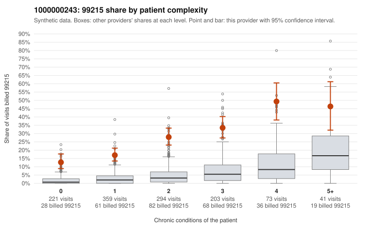

# Payment Integrity dossier: 1000000243

> Draft for human review. Statistical and records-sample evidence only; not a finding. Compliance or legal review is needed before any provider contact, notice or recoupment.

## Provider overview

| | |
|---|---|
| Specialty / state | Family Practice, GA (synthetic) |
| Claims / patients | 1,191 / 608 |
| Billed mix (99211 to 99215) | 2 / 2 / 121 / 772 / 294 |
| 99215 share | 24.7% |
| Expected 99215 share given patient complexity | 3.4% |
| Screen scores | z vs peers 3.71; risk-adjusted 13.92; flagged by suspicion>=5 |

## Case summary (advisory)

**Provider 1000000243's 99215 rate is elevated well beyond expectation at every complexity level, including patients with no chronic conditions, while the records returned are too few to confirm or rebut the billing.**

Leaning: pattern consistent with upcoding. Citations checked: 3/3 valid.

1000000243 billed 99215 on 24.7% of 1,191 claims against an expected 3.4% given patient complexity (risk-adjusted score 13.92; plain z-score vs peers 3.71). 30% of this provider's 99215 claims were on patients with 0 or 1 chronic conditions. Records came back for 30 claims. Of 5 documented 99215 claims, 0 (0%) were documented below the billed level, against 0% for the comparison providers. 2 of 21 notes claiming moderate-or-higher data reviewed had no lab or test line on the claim. The excess cannot be explained by a sicker panel: the 99215 share runs several times the all-provider rate in every complexity band, and nearly a third of 99215s fall on patients with 0–1 conditions. The sampled low-complexity 99215s are mostly simple presentations such as back pain (M54.50), rash (R21), URI (J06.9), UTI (N39.0) and follow-up (Z09) in young or single-condition patients (e.g., C0125114, C0125148, C0125651, C0125670), a pattern consistent with upcoding. The high-complexity sampled 99215s (e.g., C0125109, C0126244) look plausible, and the documentation found no unsupported 99215s, but only five 99215 charts came back, so the documentation is too thin to judge either way. One supported high-MDM chart, C0125950, is a single-condition depression visit with minutes not recorded, and the 2 of 21 notes claiming moderate-or-higher data review with no lab or test line are only weak signals of templated notes. A reviewer should first request charts for the sampled low-complexity 99215 claims, starting with the 0-condition visits, and check whether the documented MDM and time genuinely support level 5 or read as cloned text. Examples: C0125077: billed 99215, patient aged 31 with 1 chronic condition(s) (type 2 diabetes). C0125095: billed 99215, patient aged 61 with 1 chronic condition(s) (type 2 diabetes). C0125114: billed 99215, patient aged 18 with 0 chronic condition(s).

## Evidence chart

## Records-review sample so far

Documentation is on file for 30 claims (2% of this provider's claims).

| Billed | Documented | Documentation below billed level | Rate | All-provider rate |
|---|---|---|---|---|
| 99213 | 4 | 0 | 0.0% | 3.9% |
| 99214 | 20 | 0 | 0.0% | 2.4% |
| 99215 | 5 | 0 | 0.0% | 0.0% |

## Recommended next steps for Payment Integrity

1. Request records for the sampled claims in `record_request_list.csv` (56 claims across 99215).
2. Review the records against E/M documentation rules and record the supported level for each claim.
3. Run the overpayment estimator on the reviewed sample (`sampling_plan.md` explains how).
4. Notice, appeal rights, recoupment, education or corrective action, and any referral are decisions for the PI team, compliance and counsel. Nothing here drafts those.

Suggested follow-ups from the case summary:

- Request the full records for the cited claims and have a certified coder re-score each against current E/M documentation rules (medical decision making or total time).
- If the re-scoring confirms the pattern, use the sampling plan in the recovery packet to review a statistical sample of this provider's 99215 claims.
- Check whether notes for the cited claims look copied forward, and whether documented minutes repeat from visit to visit.

## Limits

- Synthetic data; no real claims or providers.
- The leaning is advisory. The flag comes from the statistical screen; the summary explains it.
- The records-review sample is partial and was simulated for this project.
- Allowed amounts are GA Family Practice averages from a public CMS file, not this provider's actual payments.
