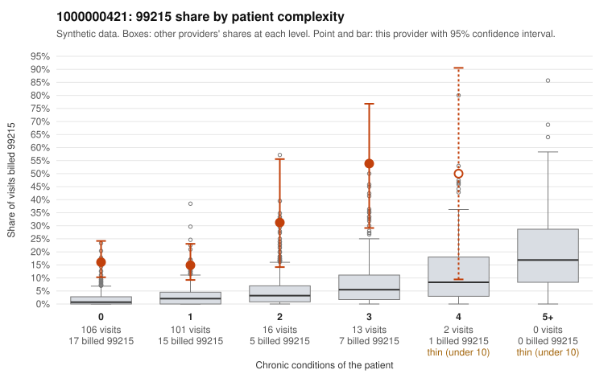

# Payment Integrity dossier: 1000000421

> Draft for human review. Statistical and records-sample evidence only; not a finding. Compliance or legal review is needed before any provider contact, notice or recoupment.

## Provider overview

| | |
|---|---|
| Specialty / state | Family Practice, GA (synthetic) |
| Claims / patients | 238 / 112 |
| Billed mix (99211 to 99215) | 0 / 1 / 65 / 127 / 45 |
| 99215 share | 18.9% |
| Expected 99215 share given patient complexity | 1.9% |
| Screen scores | z vs peers 2.63; risk-adjusted 6.58; flagged by suspicion>=5 |

## Case summary (advisory)

**1000000421: 5 of 9 documented 99215 claims (56%) are documented below the billed level**

Leaning: pattern consistent with upcoding. Citations checked: 6/6 valid.

1000000421 billed 99215 on 18.9% of 238 claims against an expected 1.9% given patient complexity (risk-adjusted score 6.58; plain z-score vs peers 2.63). 71% of this provider's 99215 claims were on patients with 0 or 1 chronic conditions. Records came back for 30 claims. Of 9 documented 99215 claims, 5 (56%) were documented below the billed level, against 0% for the comparison providers. 1 of 16 notes claiming moderate-or-higher data reviewed had no lab or test line on the claim. This pattern is consistent with upcoding. It is a reason to review the records, not a finding. Examples: C0208934: billed 99215; documented MDM level moderate, minutes not recorded. C0208975: billed 99215, patient aged 58 with 0 chronic condition(s); documented MDM level moderate, 33 minutes. C0208983: billed 99215, patient aged 32 with 1 chronic condition(s) (type 2 diabetes); documented MDM level moderate, 39 minutes. C0208854: billed 99215, patient aged 71 with 0 chronic condition(s). C0208861: billed 99215, patient aged 32 with 0 chronic condition(s). C0208865: billed 99215, patient aged 40 with 1 chronic condition(s) (type 2 diabetes).

## Evidence chart

## Records-review sample so far

Documentation is on file for 30 claims (13% of this provider's claims).

| Billed | Documented | Documentation below billed level | Rate | All-provider rate |
|---|---|---|---|---|
| 99213 | 6 | 0 | 0.0% | 3.9% |
| 99214 | 15 | 3 | 20.0% | 2.4% |
| 99215 | 9 | 5 | 55.6% | 0.0% |

## Recommended next steps for Payment Integrity

1. Request records for the sampled claims in `record_request_list.csv` (28 claims across 99215).
2. Review the records against E/M documentation rules and record the supported level for each claim.
3. Run the overpayment estimator on the reviewed sample (`sampling_plan.md` explains how).
4. Notice, appeal rights, recoupment, education or corrective action, and any referral are decisions for the PI team, compliance and counsel. Nothing here drafts those.

Suggested follow-ups from the case summary:

- Request the full records for the cited claims and have a certified coder re-score each against current E/M documentation rules (medical decision making or total time).
- If the re-scoring confirms the pattern, use the sampling plan in the recovery packet to review a statistical sample of this provider's 99215 claims.
- Check whether notes for the cited claims look copied forward, and whether documented minutes repeat from visit to visit.

## Limits

- Synthetic data; no real claims or providers.
- The leaning is advisory. The flag comes from the statistical screen; the summary explains it.
- The records-review sample is partial and was simulated for this project.
- Allowed amounts are GA Family Practice averages from a public CMS file, not this provider's actual payments.
