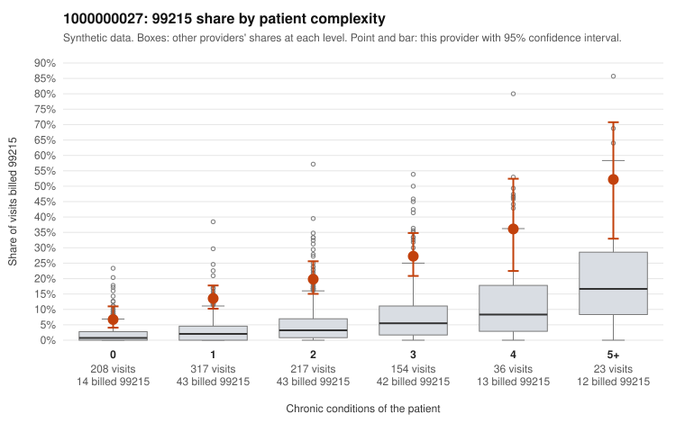

# 1000000027: Provider 1000000027 bills 99215 well above expectation in every complexity tier, including patients with no chronic conditions, but the small set of returned charts mostly supports the billed level, so the picture is unresolved.

**Leaning (advisory):** Inconclusive

## Why

1000000027 billed 99215 on 17.5% of 955 claims against an expected 3.1% given patient complexity (risk-adjusted score 8.86; plain z-score vs peers 2.36). 34% of this provider's 99215 claims were on patients with 0 or 1 chronic conditions. Records came back for 45 claims. Of 20 documented 99215 claims, 2 (10%) were documented below the billed level, against 0% for the comparison providers. Note checks on 45 returned notes (share showing each sign): problems 24%, late 7%, unsigned 0%, data 9%. No audit trail was received. 4 of 36 notes claiming moderate-or-higher data reviewed had no lab or test line on the claim. The by-complexity table shows the 99215 share rising with condition count but sitting roughly three to four times the all-provider share in every tier, including 0-condition visits for complaints like back pain, rash and URI (e.g., C0015082, C0015159, C0015252). A uniform uplift like that fits a coding habit better than a sicker panel. Against that, 18 of the 20 documented 99215 claims were supported, and the 2 unsupported ones (C0015354, C0015970, moderate MDM at about 30 minutes) are too few to call the rate meaningfully elevated. Records cover under 5% of claims and no audit trail was received, so the documentation is thin, and it may itself be inflated. Low-complexity visits such as C0015212 (0 conditions, back pain, high MDM, no time recorded, also flagged for data reviewed) and C0015533 deserve scrutiny for templated or cloned content, as do the time-repeat and problem-list signals. A reviewer should first pull full notes and the EHR audit trail for the sampled low-complexity 99215 claims, then request a larger, targeted records sample of 0-1 condition 99215 visits to test whether high MDM is genuinely documented there. Examples: C0015354: billed 99215; documented MDM level moderate, 32 minutes. C0015970: billed 99215; documented MDM level moderate, 30 minutes. C0015082: billed 99215, patient aged 42 with 0 chronic condition(s). C0015089: billed 99215, patient aged 32 with 0 chronic condition(s).

## Evidence chart

## Cited claims

`C0015354`, `C0015970`, `C0015082`, `C0015089`

## Suggested next steps

- 45 charts came back but do not settle it: request a targeted sample of 99215 charts, starting with C0015354, C0015970, C0015082.
- Re-check after the targeted charts arrive; do not call upcoding or a sicker panel on this evidence alone.

---
Citations checked: 4/4 valid. Synthetic data. The leaning is advisory; the flag comes from the statistical screen, and no clinical documentation is available beyond the sampled records-review facts shown in the packet.
