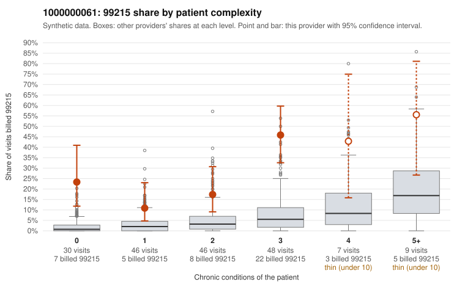

# 1000000061: Provider 1000000061 bills 99215 far above the complexity-expected rate, including on patients with no chronic conditions, but every returned 99215 chart supports the billed level, so the pattern is unresolved.

**Leaning (advisory):** Inconclusive

## Why

1000000061 billed 99215 on 26.9% of 186 claims against an expected 3.8% given patient complexity (risk-adjusted score 5.64; plain z-score vs peers 4.13). 24% of this provider's 99215 claims were on patients with 0 or 1 chronic conditions. Records came back for 45 claims. Of 20 documented 99215 claims, 0 (0%) were documented below the billed level, against 0% for the comparison providers. Note checks on 45 returned notes (share showing each sign): problems 16%, late 2%, unsigned 0%, data 4%. No audit trail was received. 3 of 37 notes claiming moderate-or-higher data reviewed had no lab or test line on the claim. The 99215 share is elevated in every complexity band, including patients with zero chronic conditions, where it is many times the all-provider rate. Sampled examples such as C0028834 and C0028890 (upper respiratory infection, J06.9) and C0028825 and C0028859 (follow-up, Z09) are low-acuity diagnoses that rarely need high-complexity decision-making. Against that, all 20 documented 99215 claims were supported, including the one-condition COPD visit C0028829. That points toward documentation that matches the billing, not toward unsupported claims. The documentation itself carries soft warning signs: problem-list flags on about one in six notes, repeated visit times, and 3 notes that claim moderate-or-higher data review with no lab or test line on the claim. With no audit trail received, these are weak signs that notes may be templated or inflated, not proof. A reviewer should first pull charts for the zero-condition 99215 sample claims (C0028834, C0028890, C0028900, C0028935) and check whether the high-MDM narrative fits the diagnosis. They should also request the EHR audit trail to test for cloned notes, starting with the flagged notes C0028796, C0028813, C0028827 and C0028949. Examples: C0028805: billed 99213; documented MDM level straightforward, 17 minutes. C0028783: billed 99215, patient aged 67 with 1 chronic condition(s) (hypothyroidism). C0028810: billed 99215, patient aged 42 with 1 chronic condition(s) (hyperlipidemia).

## Evidence chart

## Cited claims

`C0028805`, `C0028783`, `C0028810`

## Suggested next steps

- 45 charts came back but do not settle it: request a targeted sample of 99215 charts, starting with C0028805, C0028783, C0028810.
- Re-check after the targeted charts arrive; do not call upcoding or a sicker panel on this evidence alone.

---
Citations checked: 3/3 valid. Synthetic data. The leaning is advisory; the flag comes from the statistical screen, and no clinical documentation is available beyond the sampled records-review facts shown in the packet.
