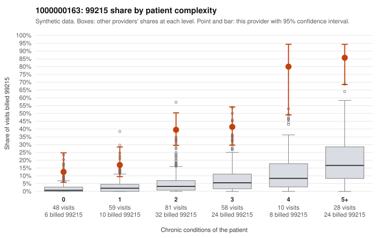

# 1000000163: Provider 1000000163 bills 99215 far above expectation in every complexity group, but the few charts returned support the billed levels, so the pattern cannot yet be called upcoding or a sicker panel.

**Leaning (advisory):** Inconclusive

## Why

1000000163 billed 99215 on 36.6% of 284 claims against an expected 4.3% given patient complexity (risk-adjusted score 9.28; plain z-score vs peers 5.95). 15% of this provider's 99215 claims were on patients with 0 or 1 chronic conditions. Records came back for 30 claims. Of 7 documented 99215 claims, 0 (0%) were documented below the billed level, against 0% for the comparison providers. Note checks on 30 returned notes (share showing each sign): problems 17%, late 3%, unsigned 0%, data 7%. No audit trail was received. 2 of 19 notes claiming moderate-or-higher data reviewed had no lab or test line on the claim. The excess 99215 share is not limited to complex patients: in the by-complexity table it is several times the all-provider share even for patients with 0 or 1 conditions, and sampled low-complexity 99215s such as C0078036 (J06.9 only) and C0078001 (Z09 only) look hard to square with high complexity, though the high-complexity sample (e.g., C0078027, C0078119) fits the billed level. Against that, all 7 documented 99215s were supported, but 7 charts is too few to clear an excess this large. The supporting notes also raise questions: C0078017, a single-condition diabetes visit documented at high MDM, is also flagged on the problems note check, one in five returned notes was flagged as duplicate, and no audit trail was received, so cloned or inflated notes cannot be ruled out. A reviewer should first request charts for the low-complexity 99215 claims listed in the packet, along with the EHR audit trail, and compare those notes for templated or duplicated content before weighing the documentation as support. Examples: C0078030: billed 99213; documented MDM level straightforward, minutes not recorded. C0077966: billed 99215, patient aged 62 with 0 chronic condition(s). C0077976: billed 99215, patient aged 53 with 1 chronic condition(s) (type 2 diabetes).

## Evidence chart

## Cited claims

`C0078030`, `C0077966`, `C0077976`

## Suggested next steps

- 30 charts came back but do not settle it: request a targeted sample of 99215 charts, starting with C0078030, C0077966, C0077976.
- Re-check after the targeted charts arrive; do not call upcoding or a sicker panel on this evidence alone.

---
Citations checked: 3/3 valid. Synthetic data. The leaning is advisory; the flag comes from the statistical screen, and no clinical documentation is available beyond the sampled records-review facts shown in the packet.
